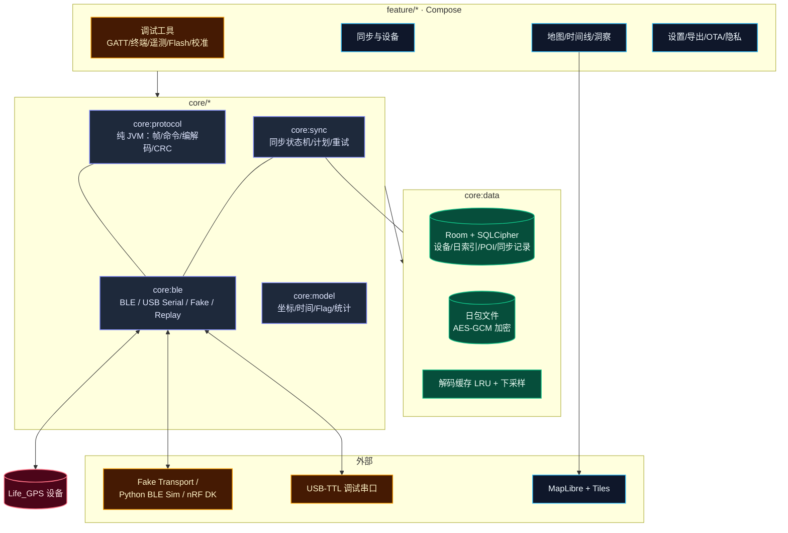
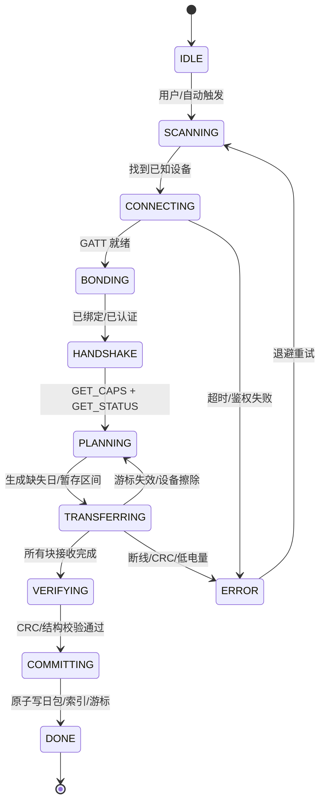
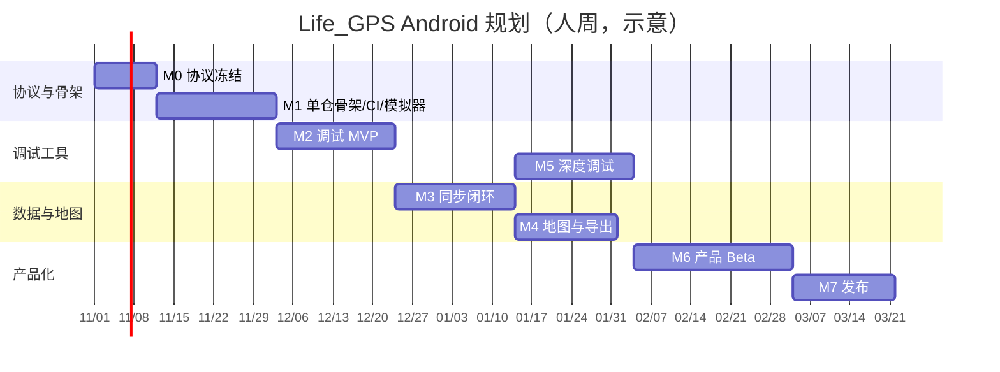

# LIFE GPS Android 应用规划（调试工具 → 产品终端）

> 文档状态：v0.1 规划草案  
> 适用范围：Android App、固件 BLE 接口联调、硬件 bring-up、产线测试  
> 关联文档：[README](../../README.md) §4（双按键）、§7（PDR/Flag）、§8（数据结构/归档/加密）、§9（LED/调试通道）、§11（Roadmap）

---

## 0. 结论摘要（TL;DR）

1. **一套代码库，两个交付形态**：`dev` flavor 是给研发/硬件/固件用的**调试与 bring-up 工具**；`prod` flavor 是给最终用户的**轨迹终端**。二者共享协议层、同步引擎、数据层和地图组件，避免维护两套 App。
2. **协议先行**：固件尚未实现 BLE 服务，App 的第一交付物不是界面，而是与固件共同冻结的 **《BLE 协议契约 v0.1》**（GATT、命令帧、同步状态机、日包格式、CRC、配对/DFU）。协议是 App 与固件之间唯一的 SSOT。
3. **无硬件也能开发**：`core:protocol` 为纯 JVM 模块 + Fake Transport + Python/nRF DK 设备模拟器 + Golden Vectors。App 可以在打样前完成 70% 的调试工具和 50% 的同步链路。
4. **推荐技术栈**：Kotlin 2.x + Jetpack Compose + Material 3 + Nordic Android-BLE-Library + Room/SQLCipher + MapLibre + WorkManager/Foreground Service + MCUboot/SMP（mcumgr）。
5. **单仓 Monorepo + GitHub Actions 全量编译**：`Firmware/`、`App/`、`Hardware/`、`protocol/`、`Doc/` 同仓；协议 YAML 一次生成 C 头文件与 Kotlin 代码，CI 分别构建固件、App 与发布包。
6. **公开仓 + 允许地图瓦片联网**：地图在线加载并做磁盘/LRU 缓存，可选离线区域；轨迹数据仍只存本地，不上传。
7. **单人负责软硬件**：App 调试工具优先于产品 UI；固件与 App 交替推进，避免协议未稳定时先做产品界面。
8. **最大工作量不在 UI，而在**：BLE 传输可靠性、日包/暂存双通道同步、OEM 后台限制、时间漂移与坐标系统、64MB 数据在手机端的索引与渲染，以及 1MB 内部 Flash 的 OTA 体积预算。
9. **估算**：App 本身约 **22.5 人周**；固件/硬件另计。1 人全职约 5 个月（App），每周 15～20 小时约 7～9 个月。

---

## 1. 目标、边界与非目标

| 维度 | 调试工具（dev） | 产品终端（prod） |
| :--- | :--- | :--- |
| 用户 | 固件/硬件/算法/测试工程师 | 最终用户（户外、数字游民、通勤记录） |
| 核心任务 | 发现设备、GATT 浏览、命令终端、实时遥测、Flash/日志检查、校准、DFU、压力测试 | 配对、每日同步、地图/时间线、POI、统计、导出、设备设置、OTA |
| 数据展示 | 原始 hex、波形、状态机、CRC/扇区、错误码 | 轨迹、热力图、海拔剖面、日历、洞察 |
| 发布方式 | 内部 APK / GitHub Actions artifact | 国内应用商店 + Google Play（可选） |
| 质量要求 | 可诊断、可复现、可导出报告 | 稳定、省心、隐私、离线可用 |

**非目标（v1 明确不做）**：
- iOS / HarmonyOS 原生版；
- 云端轨迹上传、社交分享、实时位置共享（与“数据主权/纯离线”定位冲突）；
- 用手机自身 GNSS 记录轨迹（手机只做终端与调试工具）；
- 依赖 Google Play Services / Firebase（国内设备与无 GMS 设备必须可用）；
- 在 App 内做复杂 GIS 编辑（只做查看、筛选、导出、简单裁剪）。

---

## 2. 设计输入与硬约束

| 约束 | 对 App 的影响 |
| :--- | :--- |
| **设备无屏幕，只有 2 键 + 3 色 LED** | App 是唯一富交互界面；设备状态、错误、电量、模式必须通过 BLE 完整暴露；App 需内置 LED 灯语说明与故障排查 |
| **BLE 5.0，nRF52840，2M PHY** | 目标 MTU 247、DLE 251；日同步（~10–12KB）应 <2s；64MB 全量转储约 15–40min，必须支持断点续传 |
| **32B 定长轨迹 + 16B 定长 Beacon，双流解耦** | 解析器零拷贝、流式；App 数据模型也必须分表/分文件，不能把 Beacon 塞进轨迹点 |
| **Life_GPS 2020 Epoch + 亚秒毫秒 + seq_id** | 需要统一时间工具与设备时钟漂移校正；`seq_id` 用于断点续传与去重 |
| **32B 记录含 CRC8，日包含 CRC32** | 每块/每天校验后才提交；损坏可重传，不污染本地库 |
| **夜间 delta + heatshrink 压缩归档，暂存区会被擦除** | **同步必须走“归档日包 + 当日暂存”双通道**；不能只按 seq 线性拉取历史 |
| **Flash AES-128-CTR 静态加密，ECDH + PIN 导出** | 设备侧解密后经 BLE 下发；App 侧仍需 Keystore + 本地加密，导出需生物识别 |
| **Zephyr RTOS / nRF Connect SDK** | OTA 选 **MCUboot + SMP（mcumgr）**；**内部 slot0 896KB + 外部 Flash 1MB slot1**；外部其余 **63MB 只存轨迹/归档**；App 镜像预算 **860KB** |
| **DEBUG_UART 115200（7P 排针）** | Android 通过 USB-C OTG + USB-TTL（推荐 CP2102N）做早期 bring-up；产品期以 BLE Log 为主 |
| **仅 Android，国内为主** | 不依赖 GMS；**允许地图瓦片联网并做磁盘/LRU 缓存**，可选离线区域；轨迹/信标数据仍只存本地，不上传 |
| **单人软硬件开发** | App 与固件不能真正并行；调试工具优先、产品 UI 后置；CI 必须按路径分流，避免互相拖慢 |
| **无电流计，只有 1M/330k 分压测电池电压** | App 只能显示电压/估算电量/充电状态；功耗闭环仍靠 PPK2 |

---

## 3. 关键决策（ADR 摘要）

| # | 决策点 | 推荐方案 | 备选 | 理由 / 备注 |
| :--- | :--- | :--- | :--- | :--- |
| D1 | BLE 栈 | **Nordic Android-BLE-Library** + 协程/Flow 封装 | Kable、RxAndroidBle、原生 API | 串行化 GATT 队列、MTU/PHY/重连成熟；与 nRF 生态一致 |
| D2 | OTA | **MCUboot + SMP over BLE（mcumgr-ble）**；内部 slot0 896KB + 外部 Flash 1MB slot1 | Nordic Secure DFU（仅 nRF5 SDK） | 外部 64MB = 63MB 轨迹 + 1MB OTA；需 M1 POC 验证跨器件 swap/DPD；镜像预算 860KB |
| D3 | 地图 | **MapLibre + OSM/OpenFreeMap/PMTiles**，高德作为可选适配器 | 高德/腾讯/百度 SDK | 免 key、可离线、WGS-84 原生；国内商用再评估高德合规与配额 |
| D4 | 坐标 | 内部一律 **WGS-84**；仅渲染层转 GCJ-02 | 全库 GCJ-02 | 避免污染原始数据；导出 GPX 必须 WGS-84 |
| D5 | 本地存储 | **日包文件为真相源 + Room 元数据/索引**，不全量入 SQLite | 全量 Room 点表 | 200 万点全量入库体积/插入/查询都吃力；日包保留原始精度 |
| D6 | 同步模型 | **App 主动拉取（pull）+ 游标/断点**，v1 单块请求，v1.1 滑动窗口 | 设备推送流 | 实现简单、天然背压、掉线可续；吞吐足够日同步 |
| D7 | 调试通道 | 自研 Control/Data/Log/Telemetry + SMP Shell/FS | 只用 NUS 文本 | 二进制高效；SMP 复用现成工具 |
| D8 | 最低版本 | **minSdk 26（Android 8.0）**；首版骨架 target/compile **35**，CI 绿后升 36 | minSdk 28/29 | 覆盖 2M PHY API（26+）与绝大多数在用机；避免首版被 AGP/SDK 版本卡住 |
| D9 | 依赖注入 | **Hilt**（多模块）或 Koin（轻量） | 手写 | 模块多、Service/Worker 多，Hilt 更省心；小团队可 Koin |
| D10 | 国内分发 | 先内部 APK，再应用商店；隐私政策 + App 备案 | 仅 GitHub | 国内商店需要备案/软著/隐私合规材料，提前准备 |
| D11 | 云 | **默认无云**；后续可选自托管 WebDAV/S3 加密备份 | 自建云 | 与产品隐私叙事一致；避免账号系统拖慢 v1 |
| D12 | 主题 | 深色优先、户外高对比、单手操作 | 浅色优先 | 户外/夜间使用场景 |
| D13 | 仓库形态 | **单仓 Monorepo**：`Firmware/` + `App/` + `Hardware/` + `protocol/` + `Doc/` | 多仓 + submodule | 协议/版本/CI 同源；固件与 App 的协议生成物一次提交、双向校验 |
| D14 | 构建 | **GitHub Actions 全量编译**：协议、固件（DK/native_sim）、App（dev/prod）、文档、Release | 本地构建 / 自建 Jenkins | 公开仓免费额度充足；需固定 Zephyr SDK/AGP/JDK 版本并缓存 |
| D15 | 仓库可见性 | **公开仓** | 私有仓 | Actions 免费；便于 issue/Release；签名密钥仍只放 secrets |
| D16 | 联网 | **允许地图瓦片联网 + 磁盘缓存 + 可选离线区域**；轨迹数据不上传 | 纯离线 | 体验与隐私平衡；地图请求是唯一网络行为 |
| D17 | 开发人力 | **单人软硬件** | 多人分工 | 调试工具优先，产品 UI 后置；避免协议未稳定时返工 |

> **已确认**：D2（OTA slot1 放外部 Flash 1MB，轨迹区 63MB）、D3（MapLibre 优先）、D8（minSdk 26）、D10（先内部 APK）、D13/D14（单仓 + GitHub Actions）、D15（公开仓）、D16（允许地图联网+缓存）、D17（单人软硬件）。  
> **无阻塞决策**；可直接进入单仓骨架与协议冻结。

---

## 4. 总体架构



**分层原则**
- `core:protocol` **不依赖 Android**，可在 JVM 单测、CLI、未来桌面调试工具中复用。
- `core:ble` 只负责“字节进、字节出”，不解析业务；通过 `Transport` 接口抽象真实 BLE、USB Serial、Fake、Replay。
- `core:sync` 是唯一允许推进同步游标、写日包、提交 Room 的组件；UI 只观察状态。
- `feature:*` 不直接碰 BLE/GATT，只调用用例；调试功能可拿到 `DebugTransport` 的原始能力。

---

## 5. BLE 协议契约 v0.1（与固件共同冻结）

> 本节是**建议基线**，需固件负责人评审后冻结为 `Doc/Software/BLE_Protocol.md`（v0.1，由 YAML 生成），并用 YAML/代码生成保证 App(Kotlin) 与固件(C) 的枚举、结构体、CRC 完全一致。

### 5.1 广播与设备标识

- 设备名：`LGPS-XXXX`（XXXX 为芯片 ID 低 16 位，十六进制）。
- 广播包含：Flags + 128-bit Service UUID + Manufacturer Data。
- Manufacturer Data（建议 ≤ 13B，Company ID 暂用 `0xFFFF` 测试，量产前申请）：
  ```
  u8  adv_ver
  u8  mode
  u8  battery_pct
  u8  storage_pct
  u16 status_flags
  u32 last_seq
  ```
- `status_flags` 广播位：`bit0 已配对`、`bit1 有待同步数据`、`bit2 正在充电`、`bit3 GNSS 已定位`、`bit4 调试模式`、`bit5 DFU 模式`。
- 扫描过滤：Service UUID + 名称前缀；App 维护“已知设备”列表，避免扫描到无关设备。

### 5.2 GATT 服务表

UUID 为**临时规划值**，冻结前统一分配：

| 角色 | UUID | 属性 | 说明 |
| :--- | :--- | :--- | :--- |
| LGPS Service | `4C475053-0001-4C47-5053-000000000001` | Primary | 主服务 |
| Status | `4C475053-0002-4C47-5053-000000000001` | Read + Notify | 设备状态快照/变化通知 |
| Control | `4C475053-0003-4C47-5053-000000000001` | Write + Indicate | 命令请求/响应 |
| Data | `4C475053-0004-4C47-5053-000000000001` | Write + Notify | 批量数据块/ACK |
| Telemetry | `4C475053-0005-4C47-5053-000000000001` | Notify | 调试遥测多路复用 |
| Log | `4C475053-0006-4C47-5053-000000000001` | Notify | 文本/二进制日志 |
| Config | `4C475053-0007-4C47-5053-000000000001` | Read + Write | 版本化配置块（带 CRC） |
| Device Info | `0x180A` | Read | 厂商/型号/固件/序列号（标准 DIS） |
| Battery | `0x180F` | Read + Notify | 标准电量（可选，与 Status 冗余） |
| SMP | `8D53DC1D-1DB7-4CD3-868B-8A527460AA84` | Write + Notify | MCUboot/mcumgr OTA 与 FS/Shell |

### 5.3 通用帧格式

**命令/响应（Control）**
```
偏移  字段          说明
0     magic 0xA5
1     ver           协议版本，当前 0x01
2     opcode
3     flags         bit0=response, bit1=more, bit2=error
4..5  seq           u16，请求/响应配对
6..7  payload_len   u16，小端
8..   payload
末尾   crc16         CRC-16/CCITT-FALSE，覆盖 magic..payload
```
- 响应 `opcode` 与请求相同，`flags.bit0=1`；payload 首字节为 `status`。
- 单帧 payload ≤ 235B（MTU 247 - 10B header - 2B CRC）。
- 所有多字节字段**小端**。

**数据块（Data）**
```
0     magic 0x5A
1     ver
2     stream        0=轨迹暂存, 1=Beacon暂存, 2=归档日包, 3=Flash原始, 4=日志回放
3     flags         bit0=first, bit1=last, bit2=error
4..7  transfer_id   u32
8..11 cursor        u32，字节偏移或 seq
12..13 payload_len  u16
14..  payload
末尾  crc16
```
- MTU 247 时 payload 最大 228B；轨迹记录 7 条/块（224B），Beacon 14 条/块（224B）。
- v1：App 发 `SYNC_READ` → 设备回一个 Data 通知；**天然背压**。
- v1.1：`SYNC_WINDOW` 允许设备连续发 N 块，App 每 N 块 ACK，用于全量转储提速。

**CRC 约定（必须冻结）**
| 用途 | 算法 | 参数 |
| :--- | :--- | :--- |
| 单条 32B 记录 | CRC-8 | poly 0x07, init 0x00, refin/refout false, xorout 0x00 |
| 帧/块 | CRC-16/CCITT-FALSE | poly 0x1021, init 0xFFFF |
| 日包/整包 | CRC-32/ISO-HDLC | 即 zlib crc32 |
| 配置块 | CRC-16/CCITT-FALSE | 同上 |

### 5.4 命令集（v0.1）

| Opcode | 名称 | 方向 | Payload | 说明 |
| :--- | :--- | :--- | :--- | :--- |
| 0x01 | GET_CAPS | App→Dev | - | 协议版本、固件版本、能力位图、MTU/PHY 建议 |
| 0x02 | GET_STATUS | App→Dev | - | 返回 Status 快照（也可直接读 Status） |
| 0x10 | SET_MODE | App→Dev | u8 mode, u8 rate_hz | 自适应/连续高精；调试可设 1/5/10Hz |
| 0x11 | SET_TIME | App→Dev | u64 utc_ms, i16 tz_min | 设备回传设置前后时钟差 |
| 0x12 | POI_MARK | App→Dev | u8 label, u16 note_len, note | App 侧 POI 下次同步下发；设备也可本地打点 |
| 0x13 | SET_CONFIG | App→Dev | TLV | 见 5.4.1 |
| 0x14 | GET_CONFIG | App→Dev | - | 返回完整配置块 |
| 0x20 | SYNC_BEGIN | App→Dev | u8 stream, u32 from_cursor | 返回 transfer_id、实际起点、总量 |
| 0x21 | SYNC_READ | App→Dev | u32 transfer_id, u32 cursor, u16 max_len | 设备回一个 Data 块 |
| 0x22 | SYNC_END | App→Dev | u32 transfer_id, u32 cursor, u32 crc32 | 设备校验并确认 |
| 0x23 | GET_DAY_INDEX | App→Dev | u16 page, u8 page_size | 归档日列表（day_id、点数、长度、CRC32、flags） |
| 0x24 | GET_ARCHIVE | App→Dev | u32 day_id, u32 offset, u16 len | 归档日包分块读取（走 Data stream=2） |
| 0x30 | LOG_SUBSCRIBE | App→Dev | u8 level, u32 module_mask | 日志级别与模块过滤 |
| 0x31 | GNSS_SNAPSHOT | App→Dev | u8 enable, u8 rate_hz | 调试：卫星列表/CN0/UBX-MON-VER |
| 0x32 | IMU_SNAPSHOT | App→Dev | u8 enable, u8 rate_hz | 调试：四元数/加速度/角速度/磁/气压/步态 |
| 0x33 | BUTTON_EVENT | Dev→App | - | 调试：按键按下/释放/时长（Notify） |
| 0x40 | SELFTEST | App→Dev | u8 mask | Flash JEDEC、传感器 WHO_AM_I、GNSS 版本、ADC、LED、按键、充电 |
| 0x41 | MAG_CAL | App→Dev | u8 step, payload | 磁校准开始/采样/结束/写入 |
| 0x42 | BARO_BASELINE | App→Dev | u8 action | 气压基准采集/清零 |
| 0x50 | ERASE_DAY | App→Dev | u32 day_id, u32 confirm | 双确认擦除某日归档 |
| 0x51 | FACTORY_RESET | App→Dev | u32 confirm | 清绑定/配置/数据（双确认） |
| 0x52 | REBOOT | App→Dev | u8 mode | 正常/DFU/Shipping |
| 0x60 | FLASH_INFO | App→Dev | - | 扇区图、擦除计数、Journal 状态 |
| 0x61 | FLASH_READ | App→Dev | u32 addr, u16 len | **仅调试解锁态** |
| 0x62 | FLASH_ERASE | App→Dev | u32 addr, u32 confirm | **仅调试解锁态** |
| 0x70 | GET_FAULT_LOG | App→Dev | - | RESETREAS、HardFault 现场、看门狗复位记录 |
| 0x71 | POWER_TEST_MARK | App→Dev | u8 label | 与 PPK2 波形对齐的时间标记 |
| 0x7F | DEBUG_UNLOCK | App→Dev | u32 challenge_resp | 进入调试态（按键序列 + 挑战响应） |

**0x13 SET_CONFIG 的 TLV key（示例）**
`0x01 记录频率`、`0x02 GNSS 超时`、`0x03 BLE 扫描占空比`、`0x04 LED 亮度`、`0x05 夜间归档时间`、`0x06 自动关机超时`、`0x07 PDR 步长 K`、`0x08 磁异常阈值`、`0x09 调试日志级别`。

**安全闸门**：`FLASH_*`、`DEBUG_UNLOCK`、`SELFTEST` 的破坏性项必须在 `prod` 固件中禁用或要求物理按键序列；App `prod` flavor 不编译这些界面。

### 5.5 同步状态机（App 侧核心）



**规划算法（关键）**
1. `GET_STATUS` 取 `archive_index_ver`、`last_seq`、电量、容量。
2. 若本地 `archive_index_ver` 落后 → `GET_DAY_INDEX` 分页拉取 → 与本地 `DayEntity` 对比，找出**缺失**与 **CRC 不一致**的 `day_id`。
3. 历史日包：按“最近优先”下载 `GET_ARCHIVE`，逐块校验 CRC32，原子写临时文件 → 校验日包 header/块 CRC → 重命名 → 建索引。用户可切换“最旧优先/仅最近 N 天”。
4. 当日暂存：`SYNC_BEGIN(stream=0, from=last_seq+1)` → 循环 `SYNC_READ` → 逐条 CRC8 校验 → 写入当日临时包 → 更新 `last_seq`；Beacon 流同理。
5. `SYNC_END` 提交；设备可标记“已同步”，但**以 App 本地校验为准**。
6. 下发 App 侧待发送 POI/配置；更新时间偏移。

**为什么必须双通道**：暂存区只有 16 个 4KB 扇区且夜间归档后会被擦除，历史数据只在归档日包中。只按 `seq_id` 拉取会丢历史；只按日包拉取会拿不到“今天尚未归档”的数据。

**断点与幂等**
- 每个 `day_id` 以 `(day_id, crc32)` 为幂等键；已存在且 CRC 一致则跳过。
- 暂存游标 `last_seq` 提交前不推进；断线后从最后确认的 `seq+1` 重试。
- 设备端 `SYNC_READ` 必须支持任意合法 cursor 重读（Flash 顺序读，天然幂等）。
- 断线重连后重新 `GET_STATUS` 校验游标；若设备已擦除/回滚，返回 `OUT_OF_RANGE`，App 重新规划。

**背压与限流**
- 同一时刻只允许 1 个未完成命令；Data 块 2s 超时，重试 3 次后重连。
- 设备电量 <10% 且未充电时，禁止 >1MB 的转储，仅允许状态/日志。
- 手机热状态 `THERMAL_STATUS_SEVERE` 时暂停大传输并提示。
- 传输期间请求 `CONNECTION_PRIORITY_HIGH`，结束后恢复 `BALANCED`；屏幕可保持常亮（可配置）。

### 5.6 归档日包格式（App 必须能解码）

```
[Header 48B]
magic "LGD1"        u32
header_ver          u16
codec               u16   (0=raw, 1=byte-delta + heatshrink)
day_id              u32   (自 2020-01-01 的天数)
record_count        u32
beacon_count        u32
traj_raw_len        u32
traj_packed_len     u32
beacon_raw_len      u32
beacon_packed_len   u32
prev_day_id         u32   (链式校验)
reserved            u32   (必须写 0，未来扩展)
flags               u16
header_crc16        u16
[Trajectory block: traj_packed_len 字节]
[Beacon block: beacon_packed_len 字节]
[Footer 8B]
traj_crc32          u32
beacon_crc32        u32
```

- **Delta 编码**：首条记录原样 32B；后续每条与上一条**逐字节模 256 差分**，再 heatshrink。App 需实现逆差分；Golden Vectors 必须覆盖跨 0xFF/0x00 回绕。
- heatshrink 参数（window 8/10、lookahead）必须写死并与固件一致；App 侧移植解码器（约 300 行），单测覆盖真实日包。
- 日包文件在 App 侧再加一层 **AES-256-GCM** 封装（`LGDE` magic + nonce + tag），密钥在 Keystore。
- **开放问题**：`altitude` 是 MSL 还是 HAE？必须由固件明确，否则地图海拔剖面会系统性偏差。

### 5.7 时间、坐标与单位

- 时间：`Instant = 2020-01-01T00:00:00Z + timestamp 秒 + subsecond_ms`；显示用手机时区。
- 设备 RTC 会漂移：每次同步记录 `(device_time, phone_time)`，App 以**分段线性偏移**校正显示；**永不改写原始时间戳**。UI 提供“原始/校正”切换。
- 坐标：存储 `int32 度×1e7`，内部一律 WGS-84；仅在高德/腾讯底图上渲染时转 GCJ-02，导出永不转换。
- 速度 `cm/s`、航向 `0.1°`、HDOP `0.1`、楼层 `int8`（0=地面，负=地下）。
- 电量：设备上报 `%` 与 `mV`；App 不做二次积分，仅展示与趋势。

### 5.8 配对、认证与密钥

Android 的 LE Secure Connections **OOB 配对没有公开 API**，设备又无屏幕，因此采用：

1. **出厂 QR 标签**：`LGPS:1:<device_id>:<X25519_pub_b64>:<claim_code>`。
2. 首次连接：Just Works 绑定（链路加密）→ App 用 QR 中的设备公钥做挑战响应 → 设备记录 App 公钥（claim）。
3. 后续连接：绑定 + `AUTH_BEGIN/AUTH_OK` 挑战响应；失败则要求按键 3s 进入重配对窗口。
4. 恢复出厂清除绑定与 App 公钥；换手机需重新 claim（可设计“导出恢复码”）。
5. **威胁模型要写清**：Just Works 绑定无法完全防配对期 MITM；QR 公钥 + claim 窗口把风险限制在“首次配对时设备已被替换/标签被拍照”。高安全场景后续可加 LED 闪烁指纹确认。
6. App 侧密钥：Android Keystore（优先 StrongBox）；数据库口令随机生成并由 Keystore 包裹；禁止备份密钥；导出需 BiometricPrompt。

### 5.9 OTA（Zephyr + MCUboot：内部 slot0 + 外部 Flash slot1）

**运行槽**：固件始终从内部 `slot0` 启动；外部 `slot1` 只是 OTA 暂存/回滚副本，由 MCUboot swap 到 slot0 后再启动，slot1 不执行、不做 XIP。

**目标**：把 slot1 放到 64MB 外部 W25Q512 的独立 1MB 分区，**内部 slot0 扩到 896KB**，解决 430KB 容量风险；外部 Flash 同时继续存轨迹，但两者严格分区、互不覆盖。

**内部 1MB 分区**

| 区域 | 偏移 | 大小 | 说明 |
| :--- | :--- | :--- | :--- |
| MCUboot | `0x00000–0x10000` | 64KB | 含 SPI NOR/flash map；M1 实测可调 |
| slot0 primary | `0x10000–0xF0000` | 896KB | 当前运行固件；镜像预算 860KB |
| scratch | `0xF0000–0xF8000` | 32KB | swap 暂存（内部，较快） |
| settings/NVS | `0xF8000–0x100000` | 32KB | 绑定/配置 |

**外部 64MB W25Q512 分区**

| 区域 | 偏移 | 大小 | 说明 |
| :--- | :--- | :--- | :--- |
| 轨迹暂存/归档/索引 | `0x0000000–0x3F00000` | 63MB | 现有两阶段存储 + AES-CTR；App 只操作此区 |
| OTA slot1 secondary | `0x3F00000–0x4000000` | 1MB | MCUboot 新固件；只签名、不加密 |

- slot0 896KB，扣除 MCUboot header/trailer（约 5KB）后，**App 镜像预算 860KB**（留约 30KB 余量）。相比内部双槽 430KB，容量翻倍，Zephyr + BLE + FS + Crypto + PDR 更从容。
- slot1 1MB = 256 × 4KB sectors；`CONFIG_BOOT_MAX_IMG_SECTORS=256`（或 auto，以实测为准），确保 MCUboot 覆盖整个外部槽。
- `slot1_partition` 必须放在外部 SPI NOR 的 `fixed-partitions` 节点；`slot0_partition`/`scratch_partition` 在内部 Flash。参考：
  ```dts
  &spi1 {
    w25q512: flash@0 {
      compatible = "jedec,spi-nor";
      reg = <0>;
      spi-max-frequency = <8000000>;
      size = <0x4000000>;
      partitions {
        compatible = "fixed-partitions";
        #address-cells = <1>;
        #size-cells = <1>;
        traj_partition: partition@0 { label = "traj"; reg = <0x0000000 0x3F00000>; };
        slot1_partition: partition@3F00000 { label = "slot1"; reg = <0x3F00000 0x100000>; };
      };
    };
  };
  ```
- 固件启用：`CONFIG_BOOTLOADER_MCUBOOT`、`CONFIG_MCUMGR_TRANSPORT_BLE`、`CONFIG_MCUMGR_GRP_IMG`、`CONFIG_MCUMGR_GRP_OS`（可选 FS）、`CONFIG_SPI_NOR`、`CONFIG_FLASH_MAP`、`CONFIG_BOOT_SWAP_USING_SCRATCH`、`CONFIG_BOOT_MAX_IMG_SECTORS=256`。
- **MCUboot 必须能访问外部 Flash**：bootloader 要编译 SPI NOR 驱动，并在初始化时**先发送 0xAB Release Deep Power-Down**，否则 App 关机/看门狗复位后 Flash 仍在 DPD，slot1 读取会失败。这是 M1 POC 的硬性验收项。
- **跨器件 swap 的约束**：Zephyr/MCUboot 文档有“两槽连续”的旧表述；nRF Connect SDK 有外部 QSPI/SPI secondary slot 的实践。M1 必须在 nRF52840 DK + W25Q512（或同系列）上验证：上传 → swap → 启动 → confirm → 回滚 → 断电恢复。若 POC 失败，回退内部双槽 456KB/槽（430KB 预算）或单槽 + 外部暂存（需批准）。
- **速度/功耗**：8MHz SPI 下 896KB swap 预计数十秒；只在 OTA 时发生，需实测并给用户进度提示；升级前要求电量 >50% 或充电中。
- **分区所有权**：App 的 Flash 管理器只使用 `traj_partition`（0–63MB），绝不写最后 1MB；MCUboot 只使用 `slot1_partition`。两边共用同一份 devicetree 分区表/生成头文件，CI 校验偏移。
- **调试命令边界**：`FLASH_INFO/READ/ERASE` 只允许访问 `traj_partition`；slot1 由 MCUboot 独占，App 不提供读写入口。
- **CI 门禁**：app `.bin` ≤860KB；签名 image ≤896KB；MCUboot ≤64KB；同时校验 `slot1_partition` 起始偏移与长度。
- App 使用 `io.runtime.mcumgr:mcumgr-ble`：上传到外部 slot1 → test → reboot → confirm → confirmed；断电/失败回滚。
- 升级包来源：优先“用户选择本地文件”；可选从配置的静态 manifest URL 检查更新。**不把 GitHub Releases 作为唯一更新源**（国内网络不可靠），manifest 可指向 GitHub、自建镜像或网盘。
- 签名：release 镜像用 MCUboot 私钥签名，私钥只放 GitHub Environment secret；仓库内只保留明确标注的 `dev` 测试密钥。

### 5.10 版本协商与兼容

- 广播 `adv_ver` + `GET_CAPS` 返回 `proto_ver`、`fw_version`、`caps_bitmap`。
- App 维护**协议兼容矩阵**：最低支持固件版本、已废弃 opcode、字段追加规则（只追加、不改变长度/含义）。
- 未知 opcode 返回 `UNSUPPORTED`，App 隐藏对应功能，不崩溃。
- 每次协议变更必须同时更新：`Doc/Software/BLE_Protocol.md`、YAML、Kotlin/C 生成物、Golden Vectors、固件单测、App 单测。

### 5.11 错误码

| 码 | 含义 | App 行为 |
| :--- | :--- | :--- |
| 0x00 | OK | 继续 |
| 0x01 | BAD_CRC | 重试该块，连续 3 次重连 |
| 0x02 | UNKNOWN_OP | 隐藏功能/提示升级 |
| 0x03 | BUSY | 500ms 退避重试 |
| 0x04 | NOT_READY | 等设备初始化，重试 |
| 0x05 | AUTH_REQUIRED | 触发配对/claim |
| 0x06 | OUT_OF_RANGE | 重新规划游标 |
| 0x07 | FLASH_ERROR | 停止传输，导出诊断 |
| 0x08 | LOW_BATTERY | 中止大传输 |
| 0x09 | UNSUPPORTED_VER | 提示升级 App/固件 |
| 0x0A | STORAGE_FULL | 提示导出/擦除 |
| 0x0B | THERMAL | 暂停并降温 |

---

## 6. 数据与本地存储

### 6.1 真相源与索引分离

```
files/
  devices/<deviceId>/
    days/<dayId>.lgd        # AES-GCM 封装的原始日包（真相源）
    staging/<date>.lgs      # 当日未归档暂存（同步完成后转为 .lgd）
    exports/                # GPX/KML/GeoJSON/CSV
    backups/                # 加密备份 zip
```

Room（SQLCipher）只存**元数据与索引**：

| 表 | 关键字段 | 用途 |
| :--- | :--- | :--- |
| `devices` | id, name, fw, proto, bondState, pubKeyFp, clockOffsetMs, lastSeq, archiveIndexVer, lastSyncAt | 设备与同步游标 |
| `days` | deviceId, dayId, state, recordCount, beaconCount, crc32, bbox(min/max lat/lon), distanceM, startTs, endTs, flagsHistogram, simplifiedPolyline BLOB, packagePath | 日历/地图概览/视口查询 |
| `beacons` | deviceId, ts, hash, major, minor, rssi, txPower, eventFlags, dayId | 信标地图/搜索（哈希，无明文 MAC） |
| `pois` | deviceId, ts, lat, lon, label, note, source, syncState | POI 列表/地图 |
| `sync_runs` | id, deviceId, startedAt, bytes, days, retries, durationMs, result, errorCode | 诊断/指标 |
| `pending_ops` | id, deviceId, type, payload, createdAt, retryCount | App 侧 POI/配置下发队列 |

**为什么不把所有点放进 SQLite**：64MB 对应最多约 200 万条 32B 记录；全量入库会带来 200MB+ 体积、批量插入耗时、地图查询与迁移成本。日包保留原始字节与完整精度；Room 只存每日 bbox + 简化折线（约 500～1500 点/日），选中某日/放大到高 zoom 时再解码完整日包（LRU 缓存 8 天）。

### 6.2 地图下采样

- 每日生成 Douglas-Peucker 简化折线（容差按 zoom 分级，例如 5m/15m/50m），存入 `days.simplifiedPolyline`。
- 视口查询用 bbox 索引；全国/全球视图只画简化线；zoom ≥14 且选中单日时解码原始点。
- 轨迹按 `status_flags` 分段渲染：GNSS 实线、PDR 虚线/琥珀色、POI 图钉、磁异常段红色警示、静止段淡化。
- Beacon 用热力/聚合点，默认关闭（隐私与性能）。
- 瓦片：MapLibre 在线瓦片 + 磁盘/LRU 缓存 + 可选离线区域；弱网/无网优先用已缓存区域；**只有地图瓦片请求联网**，轨迹/信标不上传。

### 6.3 加密与备份

- 日包：AES-256-GCM，每文件随机 nonce；密钥在 Keystore（StrongBox 优先）。
- Room：SQLCipher，口令 32B 随机数由 Keystore 包裹；`android:allowBackup=false`，排除密钥与数据库。
- 导出：默认明文 GPX/KML/GeoJSON（用户明确操作 + 生物识别）；可生成“脱敏导出”（裁剪起终点、家庭半径模糊、去除 Beacon）。
- 加密备份：zip（日包 + Room 导出 JSON + 设备元数据），口令由用户设置或恢复码派生；支持跨手机恢复。
- 应用锁：BiometricPrompt；最近任务缩略图可选 `FLAG_SECURE`。

### 6.4 导出格式

| 格式 | 内容 | 备注 |
| :--- | :--- | :--- |
| GPX 1.1 | trkpt + time + ele + speed/heading extensions + HDOP/sats/flags | WGS-84；兼容 Strava/Garmin |
| KML 2.2 | LineString + Placemark（POI） | Google Earth |
| GeoJSON | FeatureCollection，properties 含质量位 | 便于 QGIS/自研分析 |
| CSV | 一行一点，含原始与校正时间 | 调试/算法分析 |
| 原始日包 | `.lgd`（可选解密为 `.lgd.raw`） | 数据主权/归档 |

---

## 7. 功能规划

> **实现状态（v0.1）**：Android `devDebug` 骨架已生成，包含硬件调试首页、串口/BLE 日志、传感器状态、GPS 状态、硬件自检、Flash/Journal、命令终端；数据来自 `FakeDebugRepository`。`app.yml` 在 GitHub Actions 构建 APK；本地不要求 Android SDK/Gradle。

### 7.1 P0 · 调试工具（dev flavor，硬件 bring-up 前就要能用）

| 模块 | 功能 | 优先级 | 验收 |
| :--- | :--- | :--- | :--- |
| 设备发现 | 扫描列表、RSSI 曲线、广播解码、原始 hex、按名称/服务过滤 | P0 | 5s 内发现目标；RSSI 1Hz 刷新 |
| 连接管理 | 连接/断开/自动重连、MTU/PHY/DLE 实际值、bond 状态、连接参数 | P0 | 显示协商结果；失败有错误码 |
| GATT 浏览器 | 服务/特征/描述符树、读/写/订阅、hex/ASCII、收藏、历史 | P0 | 可完成任意特征读写 |
| 命令终端 | 从协议 YAML 生成命令表单、hex 编辑器、响应解码、宏/脚本、循环发送 | P0 | 可脚本化 bring-up |
| 状态面板 | 电量/充电、模式、GNSS 六状态、星数/HDOP、Flash 用量、记录数、复位原因 | P0 | 与 LED 灯语一致 |
| 日志控制台 | BLE Log + USB Serial 双源、级别/模块过滤、暂停/滚动、导出 | P0 | 115200 串口稳定；时间戳可对齐 |
| Bring-up 清单 | 扫描→连接→读 DIS→状态→设时→Flash ID→传感器 ID→GNSS 版本→首定位→记录→同步→解析，逐项 PASS/FAIL | P0 | 一键生成报告（JSON/Markdown） |
| Flash 检查器 | 16 扇区图、erase_count、Journal 状态、日包索引、CRC 校验、扇区 dump | P1 | 可定位掉电/归档异常 |
| 实时遥测 | GNSS 星空图/CN0、IMU 四元数 3D 立方、加速度/角速度曲线、磁模长、气压/楼层、PDR 步态/ZUPT、系统堆栈/循环耗时 | P1 | 10–60Hz 可配；CSV 导出 |
| 空间轨迹 | IMU/PDR 局部坐标 3D 轨迹、距离/采样点/ZUPT 可视化 | P1 | 用于检查航向漂移与步长 |
| 地图实时轨迹 | GNSS 实时画线、当前位置、点击打点、POI 列表 | P1 | 先 Canvas 占位，后接 MapLibre |
| 校准向导 | 磁硬铁/软铁椭球拟合（球面覆盖进度）、加速度水平、气压基准 | P1 | 校准前后航向对比 |
| DFU | SMP 镜像上传、test/confirm、回滚、版本校验 | P1 | 断电/断线可恢复 |
| 压力测试 | 定时连接/同步/读状态、断线统计、错误注入、7×24 报告 | P2 | 生成成功率/吞吐报表 |
| 会话录制/回放 | 记录所有 GATT 操作与通知到 `.lgpsr`，离线回放给 UI/单测 | P2 | 复现现场问题 |

**调试工具的“杀手级”页面**：一块 **Live Bench** 屏，同时显示 GNSS 状态机、CN0 柱状图、IMU 姿态、PDR vs GNSS 轨迹小地图、Flash 写入计数、电量/电压、日志尾部。硬件/算法调试时一屏定位问题。

### 7.2 P1 · 产品终端（prod flavor）

| 模块 | 功能 | 优先级 |
| :--- | :--- | :--- |
| 引导 | 扫码/手动添加、claim、权限说明、LED/按键教学、隐私政策 | P0 |
| 首页 | 设备卡（电量/充电/模式/存储/上次同步）、一键同步、今日轨迹预览、待同步提醒 | P0 |
| 同步 | 增量日包 + 当日暂存、进度/取消/断点、低电量保护、失败诊断 | P0 |
| 地图 | 日轨迹、PDR/异常分段、POI、海拔剖面联动、播放、**在线瓦片 + 磁盘/LRU 缓存 + 可选离线区域** | P0 |
| 日历/时间线 | 年热力图、按月/年统计、连续记录天数 | P1 |
| 设备设置 | 自适应/连续模式、记录频率、LED 亮度、归档时间、自动关机、校准、工厂复位 | P1 |
| 数据 | GPX/KML/GeoJSON/CSV 导出、脱敏导出、加密备份/恢复、删除某日 | P1 |
| 洞察 | 距离/时长/爬升、GNSS vs PDR 占比、存储/电量预测、数据质量 | P2 |
| OTA | 本地固件文件导入 / 可选 manifest 检查、版本说明、电量门槛、失败回滚 | P1 |
| 通知/Widget | 同步完成、低电量、存储不足；桌面小组件“立即同步” | P2 |
| 诊断 | 连接诊断、同步指标、导出诊断包（脱敏） | P1 |

**产品原则**
- **零配置**：打开 App 靠近已知设备即可同步；不要求用户理解 GATT。
- **本地优先**：默认无账号、无上传；所有文案明确“数据只在这台手机”。
- **可解释**：PDR 段、丢星、磁异常、低质量点必须在 UI 上可见，而不是假装完美。
- **可恢复**：换手机/重装/丢密钥都有明确路径（恢复码/重新 claim/加密备份）。

---

## 8. 技术栈

| 层 | 选型 | 备注 |
| :--- | :--- | :--- |
| 语言/UI | Kotlin 2.x、Jetpack Compose、Material 3、Navigation Compose | 单 Activity；深色优先 |
| 异步 | Coroutines + Flow、Turbine（测试） | 结构化并发；BLE 队列串行 |
| BLE | `no.nordicsemi.android:ble` | 处理 GATT 队列、MTU、PHY、重连 |
| OTA | `io.runtime.mcumgr:mcumgr-ble` | SMP/MCUboot |
| 串口 | `com.github.mik3y:usb-serial-for-android` | CP210x/CH34x/FTDI；OTG |
| 存储 | Room + SQLCipher、DataStore、Okio | 日包文件 + 索引 |
| 地图 | MapLibre Native Android | 离线区域/PMTiles 需 M4 前 spike |
| 图表 | Vico（Compose）或自绘 Canvas | 海拔/速度/电量；姿态用 Canvas |
| DI | Hilt 或 Koin | 多模块推荐 Hilt |
| 序列化 | kotlinx-serialization（配置/报告）；二进制手写 ByteBuffer | 协议零依赖 |
| 加密 | Android Keystore + AES-GCM；SQLCipher | 生物识别门禁 |
| 后台 | Foreground Service（connectedDevice）+ WorkManager | Android 14 FGS 类型；不承诺后台常驻扫描 |
| 测试 | JUnit4/5、Robolectric、MockK、Compose UI Test、Roborazzi/Paparazzi | 协议纯 JVM 快测 |
| 质量 | detekt、ktlint、Android Lint、dependency-analysis | CI 门禁 |
| 构建 | Gradle Kotlin DSL + Version Catalog、JDK 17、AGP 8.x | `dev`/`prod` flavor；APK splits/App Bundle |

---

## 9. 单仓（Monorepo）结构、构建与发布

### 9.1 仓库布局

```
Life_GPS/
├── .github/workflows/              # protocol / app / firmware / hardware / release / docs
├── App/                            # Android（Kotlin + Compose）
│   ├── settings.gradle.kts
│   ├── build.gradle.kts
│   ├── gradle/libs.versions.toml
│   ├── app/                        # 入口、导航、DI、dev/prod flavor
│   ├── core/
│   │   ├── protocol/               # 纯 JVM：帧、CRC、记录/日包编解码、命令模型
│   │   ├── ble/                    # Transport：BLE / USB Serial / Fake / Replay
│   │   ├── sync/                   # 同步状态机、计划、重试、指标
│   │   ├── data/                   # Room、日包仓库、加密、导出、备份
│   │   ├── model/                  # 时间/坐标/Flag/统计/下采样
│   │   └── designsystem/           # 主题、组件、图标
│   ├── feature/
│   │   ├── onboarding/             # 扫码/claim/权限
│   │   ├── devices/                # 设备列表/状态/设置
│   │   ├── sync/                   # 同步 UI/诊断
│   │   ├── map/                    # 地图/剖面/播放
│   │   ├── timeline/               # 日历/热力图/洞察
│   │   ├── debug/                  # GATT/终端/遥测/Flash/校准/Bring-up
│   │   └── settings/               # 导出/备份/OTA/隐私
│   ├── simulator/                  # JVM Fake Device + 场景脚本 + Golden 回放
│   └── docs/
├── Firmware/                       # Zephyr RTOS / nRF Connect SDK
│   ├── west.yml                    # 固定 Zephyr 与模块 revision
│   ├── boards/lifegps/             # 自定义 nRF52840 板级定义
│   ├── src/                        # 电源状态机/GNSS/IMU/PDR/存储/BLE
│   ├── include/generated/          # 协议生成 C 头文件（CI 校验）
│   └── tests/                      # native_sim / twister 单测
├── Hardware/
│   ├── Schematic/  PCB/  BOM/  Production/
├── protocol/
│   ├── lifegps_protocol.yaml       # 协议 SSOT：UUID/命令/枚举/结构/CRC
│   └── vectors/                    # Golden Vectors（C/Kotlin 共用）
├── tools/
│   ├── protocol-gen/               # YAML → Kotlin/C/Markdown
│   ├── ble-sim/                    # Python BLE 外设模拟器
│   └── ci/                         # 体积门禁、校验和、发布脚本
├── Doc/                            # 文档中心
│   ├── Hardware/                   # 规格书/Stackup/架构图
│   └── Software/                   # Android 规划/入门/BLE 协议
├── .devcontainer/                  # 可选：统一 JDK/Python/Android SDK
├── Makefile                        # bootstrap/proto/fw/app/test/release
├── versions.yaml                   # Zephyr SDK/JDK/AGP/Kotlin/协议版本锁定
├── CHANGELOG.md
└── README.md
```

**Flavor 差异**
- `dev`：包含 `feature/debug`、Fake/Replay、原始 Flash 读写、详细日志、`applicationId` 加 `.dev`。
- `prod`：移除调试入口与破坏性命令；仅保留用户诊断；默认关闭遥测与第三方 SDK。
- `dev` 可加 `demo` source set，用预置日包做 UI 截图/预览，无需真机。

### 9.2 共享协议与代码生成

`protocol/lifegps_protocol.yaml` 是固件与 App 的唯一协议来源，至少定义：GATT UUID、命令/响应 opcode、枚举与位域、结构体字段与偏移、CRC 参数、日包格式、协议版本。

生成物**签入仓库**，CI 校验不漂移：

| 生成物 | 路径 | 消费方 |
| :--- | :--- | :--- |
| C 头文件 | `Firmware/include/generated/lifegps_protocol.h` | 固件；含 `_Static_assert` 尺寸断言 |
| Kotlin 模型/编解码 | `App/core/protocol/src/main/kotlin/.../GeneratedProtocol.kt` | App |
| 协议文档表格 | `Doc/Software/BLE_Protocol.md` | 人读/评审 |

- `make proto`：生成 + 格式化 + 单测。
- `make proto-check`：重新生成后 `git diff --exit-code`，任何漂移直接 fail。
- Golden Vectors 同时被 Kotlin JVM 测试与固件 `native_sim` 测试读取，保证字节级一致。

### 9.3 GitHub Actions 全量编译

| Workflow | 触发路径 | 关键步骤 | 产物 |
| :--- | :--- | :--- | :--- |
| `protocol.yml` | `protocol/**`、`tools/protocol-gen/**`、`App/core/protocol/**`、`Firmware/include/generated/**` | Python 3.12 + JDK 17；`make proto-check`；`pytest`；`:core:protocol:test` | 测试报告、生成物 diff |
| `firmware.yml` | `Firmware/**`、`protocol/**`、`tools/**` | Zephyr 官方 action/容器；缓存 modules/SDK/ccache；release 构建；DK mock 构建；`twister -p native_sim`；体积门禁；dev 签名 | `zephyr.hex`、`zephyr.bin`、`dfu_application.zip`、`zephyr.map`、`size-report.json` |
| `app.yml` | `App/**`、`protocol/**`、`versions.yaml` | JDK 17 + Android SDK 35 + Gradle 缓存；`assembleDevDebug`、`testDevDebugUnitTest`、`lintDevDebug` | `app-dev-debug.apk` artifact |
| `release.yml` | tag `app-v*` / `fw-v*` / `hw-v*` | Release Environment 审批；签名；校验和；SBOM；生成 Release Notes | 签名 APK/AAB/mapping、固件 hex/bin/DFU、Gerber/BOM、`SHA256SUMS` |
| `docs.yml` | `**/*.md` | 相对链接检查（`tools/ci/check_links.py`）；后续加 markdownlint/REUSE | 检查报告 |
| `hardware.yml`（可选） | `Hardware/**` | KiCad CLI ERC/DRC/Gerber/BOM（若工程为 KiCad）；立创 EDA 导出物做归档与 BOM/坐标校验 | Gerber zip、BOM、坐标文件 |

> 实现建议：上表是**逻辑拆分**，不是必须 5 个文件。为便于 required checks，推荐合并为一个 `ci.yml`，用 `dorny/paths-filter` 决定哪些 job 运行，最后用 `ci-gate` 聚合；若坚持多 workflow，则**不要**把会被 skip 的 workflow 设为 required check。

**单仓不等于全量编译**

App 与 Firmware 是两套**独立构建系统**（Gradle / west），单仓只共享版本与协议，不共享构建图。CI 用 `paths:` 过滤，只有改动到的组件才构建：

| 改动范围 | 触发工作流 | 预计耗时（有缓存） |
| :--- | :--- | :--- |
| `App/**` | protocol + app | 7～10 min |
| `Firmware/**` | protocol + firmware | 7～12 min |
| `protocol/**` | protocol + app + firmware | 12～20 min（契约变更必须全验） |
| `Hardware/**` | hardware（+ docs 可选） | 2～5 min |
| `Doc/**`、`README.md` | docs | 1～2 min |
| `main` 推送 | 按改动路径；可加 nightly 全量 | 同上 |
| tag | release 全量 | 20～30 min |

- **本地**：`make app` / `make fw` 各自增量编译；Android Studio 打开 `App/`，VS Code/CLion 打开 `Firmware/`，互不干扰。
- **CI 取消旧运行**：每个 workflow 加 `concurrency`，同一分支新提交自动取消旧运行：

```yaml
concurrency:
  group: ${{ github.workflow }}-${{ github.ref }}
  cancel-in-progress: true
```

- **必需检查**：路径未触发的 job 会被 skip。推荐用单 `ci.yml` + `dorny/paths-filter` + 一个 `ci-gate` 聚合 job（`needs: [protocol, app, firmware]` + `if: always()`）作为唯一 required check；若坚持多 workflow，则分别把各 workflow 设为 required，并确认 skipped 语义。
- 真正需要全量的只有：**协议变更、`main` 基线、release tag**。公开仓 Actions 免费，成本主要是 wall-clock，不是额度。

**什么时候才需要拆仓**

- 触发条件：多人高频并行、CI 排队明显、固件/App 发布节奏完全独立、许可/权限要求不同。
- 拆分方式：`lifegps-protocol` 独立成版本化包（GitHub Packages 或 git submodule），App/Firmware 各自仓库。
- 单人阶段不建议拆：协议/版本同步成本 > CI 节省的时间；先享受单仓的“一次提交、双端校验”。

**本地等价命令（Makefile）**

```bash
make bootstrap   # 检查 JDK17/Android SDK/Python/west，安装依赖
make proto       # 生成协议代码 + 单测
make proto-check # 生成物漂移检查
make fw          # west build -b lifegps/nrf52840
make fw-dk       # west build -b nrf52840dk_nrf52840（mock 传感器/轨迹）
make fw-test     # twister -p native_sim
make app         # ./gradlew :app:assembleDevDebug
make app-test    # 单测 + lint + detekt
make release     # 签名产物 + SHA256SUMS
```

**CI 要点**
- **路径过滤**：文档改动不触发固件/App 构建；协议改动同时触发三方校验。
- **缓存**：Gradle（`gradle/actions/setup-gradle@v4`）、Android SDK、Zephyr modules/SDK/ccache；缓存 key 绑定 `versions.yaml` 与 `Firmware/west.yml` 的哈希。
- **固定工具链**：Zephyr revision、Zephyr SDK、Python 依赖、JDK、AGP、Kotlin 全部写进 `versions.yaml`/lockfile；release 用容器 digest，保证可复现。
- **构建耗时**：见上表；公开仓 Actions 免费。若未来转私有仓，注意 2000 min/月额度，必要时自建 runner。
- **必需检查**：`protocol`、`app`、`firmware`（含体积门禁）通过 `ci-gate` 聚合后作为 `main` 分支保护 required checks。

### 9.4 版本、发布与密钥

- **独立 SemVer**：`protocol`、`firmware`、`app` 各自版本；tag 形如 `app-v0.3.0`、`fw-v0.2.1`、`hw-v0.1`。
- `versions.yaml` 同时锁定：协议版本、Zephyr revision/SDK、JDK、AGP、Kotlin、compile/target/minSdk。
- 固件与 App 都嵌入 `GIT_SHA`、`BUILD_TIME`、`PROTO_VER`；调试页显示，现场问题可直接定位构建。
- **Release 资产**：APK/AAB + `mapping.txt`；固件 `hex/bin/dfu_application.zip` + `zephyr.map` + 体积报告；硬件 Gerber/BOM/坐标文件；统一 `SHA256SUMS` 与 SBOM。
- **签名**：Android keystore 与 MCUboot 私钥只放 GitHub Environment `release` 的 secrets，启用 required reviewers；仓库内仅保留明确标注的 `dev` 测试密钥。
- **最小权限**：默认 `permissions: contents: read`；仅 release job 申请 `contents: write`。禁止在 PR 工作流中使用 release secrets。
- **可复现**：west revision、SDK、Python lock、Gradle lockfile/verification、容器 digest 全部固定；同一 tag 重跑应得到一致的 SHA256（或差异可解释）。

### 9.5 仓库体积、许可与质量

- **不提交构建产物**：`build/`、`twister-out/`、`*.apk`、`*.aab`、`*.hex`、`*.bin`、`*.zip` 全部进 `.gitignore`，只作为 Release 资产。
- **`.gitignore` 要点**：`App/.gradle/`、`App/**/build/`、`App/local.properties`、`.idea/`；Zephyr `build/`、`twister-out/`、`.west/`、`zephyr/`、`modules/`、`bootloader/`；任何 `*.jks`/`*.pem`/`*.key`。
- **大文件**：当前 `Doc/Hardware/Datasheets/*.pdf` 约 30MB 可接受；Gerber/STEP/坐标文件增大后，对 `Doc/Hardware/Datasheets/*.pdf`、`Hardware/Production/**`、`*.step`、`*.zip` 启用 Git LFS（注意免费额度 1GB 存储/1GB 月流量）。
- **许可**：硬件 CERN-OHL-S-2.0、软件 MIT；协议/文档可选 CC-BY-4.0；每个目录加 SPDX 头，使用 REUSE 校验。
- **质量门禁**：CodeQL（Kotlin/C）、Dependabot、secret scanning、`git-sizer`/单文件大小检查、PR 模板与 issue 模板。
- **分支策略**：trunk-based，`main` 保护 + 短分支 PR + squash merge；发布用 tag，不维护长期 `develop`。

---

## 10. 无硬件开发与联调体系

这是整个计划能否与固件并行的关键。

| 手段 | 作用 | 落地 |
| :--- | :--- | :--- |
| **Fake Transport（JVM）** | UI/同步/解析在 CI 与模拟器上跑 | 按脚本返回 Status/Data；可注入断线、CRC 错、BUSY、低电量 |
| **Python BLE Simulator** | 真手机连“假设备”，验证 Android BLE 栈 | `bless` + BlueZ（Linux）/ macOS；同 UUID、同 MTU 247、同帧格式；合成 30 天轨迹与日包 |
| **nRF52840 DK 模拟固件** | 验证 2M PHY/DLE/真实 Zephyr 栈 | 固件加 `CONFIG_LGPS_MOCK_DATA`，用合成传感器/轨迹；与真机同协议 |
| **Golden Vectors** | App 与固件解析结果逐字节一致 | `protocol/vectors/`：32B 记录、16B Beacon、命令帧、日包、跨 0xFF delta、heatshrink |
| **会话录制/回放** | 现场问题可复现 | `.lgpsr`（JSONL + 二进制附件）；回放驱动 UI 与单测 |
| **协议代码生成** | 防止枚举/结构体漂移 | YAML → Kotlin + C header；CI 检查生成物是否最新 |
| **USB-TTL 串口** | BLE 未就绪时的唯一可见通道 | 7P H1：DEBUG_TXD P0.24 / DEBUG_RXD P1.00；CP2102N 小板 |
| **CI** | 每次提交跑协议/固件/App 逻辑测试与构建 | GitHub Actions 分 workflow：protocol / firmware / app / docs；真机 BLE 不进 CI |

**联调顺序建议**
1. App ↔ Fake：协议/同步/解析全绿。
2. App ↔ Python Sim：Android BLE 连接、MTU、通知、断线重连。
3. App ↔ nRF DK：2M PHY、DLE、吞吐、SMP DFU。
4. App ↔ 真板：bring-up 清单逐项过。
5. 真板 + 真人 + 真轨迹：7 天连续记录 → 同步 → 地图/导出 → 与 PPK2/参考 GPS 对比。

---

## 11. 里程碑与排期

按 **人周** 估算（1 人；含自测，不含固件功能开发，但含固件 CI 骨架）：

| 里程碑 | 内容 | 人周 | 退出标准 | 固件依赖 |
| :--- | :--- | :--- | :--- | :--- |
| **M0 协议冻结** | `BLE_Protocol_v0.1`、YAML、Golden Vectors、UUID/CRC/日包 | 1.5 | 固件/App 双方评审签字；向量双方单测通过 | 固件负责人参与 |
| **M1 单仓骨架/CI** | Monorepo 布局、Makefile/versions.yaml、protocol-gen、Firmware/App 骨架、Fake Transport、**外部 slot1 固件 POC** | 3 | protocol/app/firmware 三条 CI 全绿；JVM/native_sim 单测通过；MCUboot 外部 slot1 上传/swap/回滚/DPD 释放 POC 通过 | 固件 CI 骨架 + 板级定义 |
| **M2 调试 MVP** | 扫描/连接/GATT/终端/状态/日志/Bring-up 清单 | 3 | 能用 Python Sim 完成全流程；真机可连 | GATT + Status/Control/Log |
| **M3 同步闭环** | 日索引、归档拉取、暂存拉取、CRC、断点、Room 索引 | 3 | 30 天模拟数据 100% 校验；断线 100 次可续 | 日包写入 + SYNC_* + 索引 |
| **M4 地图与导出** | MapLibre、日轨迹、PDR 分段、剖面、GPX/KML/GeoJSON | 2.5 | 10 万点视图流畅；导出通过 schema 校验 | 无（用模拟数据） |
| **M5 深度调试** | 遥测曲线/姿态、Flash 检查、校准、DFU、压力测试 | 3 | 7×24 压测报告；DFU 断电可回滚 | Telemetry、Flash、SMP |
| **M6 产品 Beta** | 引导/首页/设置/时间线/通知/诊断/加密备份 | 4 | 5 台 OEM 真机通过；7 天真实轨迹闭环 | 稳定固件 + 量产板 |
| **M7 发布** | 性能/无障碍/隐私合规/商店材料/签名 | 2.5 | 崩溃率、同步成功率达标；Release 资产齐全 | 认证/备案 |

**App 总计约 22.5 人周**（固件/硬件另计）。单人软硬件节奏：
- **先调试工具，后产品 UI**：M0 协议 → M1 单仓/CI/调试骨架 → M2 调试 MVP；这套工具直接用于固件 bring-up，是后续工作的放大器。
- **M3 同步闭环与固件 F2/F3 交替推进**：App 先用 Fake/Python Sim 把日包/断点/CRC 逻辑跑通，固件就绪后只做联调。
- **M4 地图/导出可在固件稳定前完成**（模拟数据）；**M6 产品 UI 最后做**，避免协议变动返工。
- 全职 1 人：App 约 5 个月；加上固件/硬件，总周期以固件里程碑为准，建议先锁定“能记录 + 能同步 + 能看图”的最小闭环。
- 每周 15～20 小时：App 约 7～9 个月；建议固定节奏（例如 3 天固件/硬件 + 2 天 App），减少上下文切换。



---

## 12. 测试与验收

### 12.1 测试分层

| 层 | 内容 | 工具 |
| :--- | :--- | :--- |
| 协议单测 | 帧/CRC/记录/日包/delta/heatshrink/异常长度 | JUnit + Golden Vectors |
| 同步单测 | 计划、断点、乱序、CRC 错、设备擦除、低电量、重连 | Fake Transport + 场景脚本 |
| 数据单测 | 时间/坐标/GCJ-02/下采样/导出 | JUnit |
| UI 测试 | 调试面板、同步进度、地图交互、权限拒绝 | Compose UI Test + Robolectric |
| 截图测试 | 调试/产品关键页 | Roborazzi/Paparazzi |
| 真机 BLE | 扫描/连接/MTU/PHY/吞吐/断线/后台 | Pixel + Samsung + Xiaomi + Huawei + OPPO/vivo |
| 现场 | 7～30 天真实轨迹、丢星、地下、电梯、磁干扰 | 与固件 Phase 3 共用路线 |
| 安全 | 密钥不落盘、备份排除、导出鉴权、绑定丢失 | 手工 + 静态扫描 |

### 12.2 验收指标（建议写进里程碑）

- **连接**：已知设备 5s 内连接成功率 ≥95%（5 台 OEM，各 50 次）。
- **日同步**：12KB/天 <2s；1MB <10s；重连后续传成功率 100%。
- **全量**：64MB 转储 <40min（v1 单块）/ <20min（v1.1 窗口），CRC 全对，断点 100 次不丢数据。
- **解析**：200 万条记录不 OOM；日包解码 <50ms/天；内存峰值 <150MB。
- **地图**：10 万点概览 ≥50fps；单日 1 万点缩放/拖动流畅；同区域二次打开命中缓存，离线区域无网可用。
- **稳定性**：7×24 压测无崩溃；同步失败可诊断；后台 30min FGS 不被杀（目标机型）。
- **安全**：APK 内无明文密钥；数据库/日包无法直接读取；导出需生物识别。
- **隐私**：除地图瓦片请求外无网络上传；轨迹/信标不上传；无 GMS 设备功能完整；权限拒绝时有降级路径。
- **数据正确性**：GPX 坐标回读误差 ≤1e-7°；时间校正开关行为可解释。
- **固件体积/OTA**：app `.bin` ≤860KB；签名 image ≤896KB；MCUboot ≤64KB；外部 slot1 1MB 偏移/长度 CI 校验通过。
- **CI/复现**：PR 通过 `ci-gate`（按路径运行 protocol/app/firmware，无失败即通过）；同一 tag 重跑产物 SHA256 一致或差异可解释。
- **单仓产物**：Release 同时提供 APK/AAB、固件 hex/bin/DFU、Gerber/BOM、`SHA256SUMS` 与 SBOM。

---

## 13. 风险与对策

| 风险 | 影响 | 概率 | 对策 |
| :--- | :--- | :--- | :--- |
| 固件 BLE/日包实现滞后 | App 空转 | 高 | 协议先行 + Python/DK 模拟器 + Golden Vectors；M3 前不依赖真板 |
| 协议双方漂移 | 联调返工 | 高 | YAML 单一来源 + 代码生成 + 双方 CI 跑同一向量 |
| Android OEM BLE 差异 | 连不上/易断 | 高 | 单请求背压、超时重试、自动重连、诊断页；5 机矩阵 |
| 64MB 全量转储太慢 | 用户体验差 | 中 | 增量同步为主；v1.1 窗口；按日导出；不鼓励全量 |
| 200 万点手机端性能 | 卡顿/占空间 | 中 | 日包 + bbox + 简化折线；LRU；分页 |
| 地图合规/坐标偏移 | 国内显示错位 | 中 | WGS-84 内部 + 渲染层 GCJ-02；高德适配器隔离 |
| 地图瓦片服务不可用/限流 | 地图空白 | 中 | 多源样式可切换；磁盘缓存；离线区域；高德适配器兜底 |
| 后台被系统杀 | 自动同步失败 | 高 | FGS + 打开即同步 + 通知提醒；不承诺常驻 |
| 配对 MITM/标签泄露 | 未授权访问 | 中 | QR 公钥 + claim 窗口 + 按键重配对；威胁模型文档化 |
| 外部 Flash slot1 跨器件 swap/DPD 不成立 | OTA 无法落地 | 中高 | M1 POC 先验证上传/swap/回滚/0xAB DPD 释放；失败回退内部双槽 456KB/槽（430KB 预算） |
| 外部 Flash 分区冲突 | 轨迹/OTA 互相覆盖 | 中 | `fixed-partitions` + 生成头文件 + CI 偏移校验；App 只写 traj_partition |
| GitHub Actions 配额/网络 | 构建排队或失败 | 中 | 公开仓免费额度；路径过滤 + 缓存；release 用 environment；必要时自建 runner/镜像 |
| 单仓密钥/权限泄露 | 供应链风险 | 中 | secrets 仅 release environment；最小权限；分支保护；Dependabot/secret scanning |
| 国内访问 GitHub 慢 | OTA/下载失败 | 中 | 固件本地文件导入；manifest 可指向镜像；Release 资产提供 SHA256 |
| 时间漂移/闰秒/时区 | 轨迹时间错 | 中 | 分段偏移校正；保留原始；显示层处理 |
| 海拔基准不明 | 剖面/楼层错 | 中 | M0 明确 MSL/HAE；日包字段注明 |
| 需求蔓延（云/社交） | 延期 | 中 | 非目标清单；v1 冻结 |

---

## 14. 决策记录（ADR）

| # | 决策 | 结论 | 状态 |
| :--- | :--- | :--- | :--- |
| 1 | 地图底图 | **MapLibre + OSM/OpenFreeMap/PMTiles**；高德作为可选适配器（渲染层转 GCJ-02） | ✅ 已确认 |
| 2 | OTA | **MCUboot + SMP（mcumgr）**；内部 slot0 896KB + 外部 Flash 1MB slot1；其余 63MB 轨迹；镜像预算 860KB | ✅ 已确认 |
| 3 | 最低 Android | **minSdk 26（Android 8.0）**，target/compile 36 | ✅ 已确认 |
| 4 | 分发 | 先内部 APK，后国内应用商店 + 可选 Google Play | ✅ 已确认 |
| 5 | 仓库/构建 | **单仓 Monorepo + GitHub Actions 全量编译**（固件/App/协议/文档/Release） | ✅ 已确认 |
| 6 | App 联网 | 允许地图瓦片联网 + 磁盘/LRU 缓存 + 可选离线区域；轨迹/信标数据不上传 | ✅ 已确认 |
| 7 | 仓库可见性 | **公开仓** | ✅ 已确认 |
| 8 | 开发人力 | **单人软硬件**；调试工具优先、产品 UI 后置 | ✅ 已确认 |

---

## 15. 下一步（第一批可执行任务）

1. **已确认**：公开仓、允许地图瓦片联网+缓存、单人软硬件；直接进入单仓骨架。
2. **搭单仓骨架**：`.github/workflows/`、`Makefile`、`versions.yaml`、`.gitignore`、`.devcontainer/`、PR/issue 模板、REUSE/许可。
3. **建立协议 SSOT**：`protocol/lifegps_protocol.yaml` + `vectors/` + `tools/protocol-gen/`，跑通 `make proto-check`。
4. **搭 App 骨架**：Gradle 多模块、`dev`/`prod` flavor、`core:protocol`、Fake Transport。
5. **搭 Firmware 骨架**：`west.yml`、`boards/lifegps/`、`prj.conf`、`native_sim` 测试、DK mock 构建；先做 **外部 SPI NOR slot1 + MCUboot swap/DPD POC**，确认 OTA 可行性与 860KB 预算。
6. **接通 CI**：`protocol.yml`、`firmware.yml`、`app.yml`，缓存与 required checks；确认体积门禁脚本。
7. **实现 M2 调试 MVP**：扫描/连接/GATT/终端/状态/日志/Bring-up 清单。
8. **搭模拟器**：Python `ble-sim`（bless）+ 合成 30 天数据 + 会话回放。
9. **发布链路**：GitHub Environment `release`、Android keystore/MCUboot 密钥 secrets、`release.yml`、`SHA256SUMS`/SBOM。
10. **硬件协同**：QR 标签格式（device_id + 公钥 + claim code）、7P 调试排针、CP2102N USB-TTL、5 台 OEM 测试机。
11. **文档联动**：把 `App/`、`Firmware/`、`protocol/`、`.github/` 写入 README §10，并在 Phase 2 勾选 App 工作流。

---

## 附录 A：32B 轨迹记录与 16B Beacon 的 App 解析要点

- 使用 `ByteBuffer.order(LITTLE_ENDIAN)`；字段偏移严格按 README §8.2，不做结构体映射。
- `seq_id`：单调递增，用于去重/断点；允许回绕（u32）。
- `timestamp + subsecond_ms`：先按原始值入库/绘图；再叠加设备时钟偏移生成“校正时间”。
- `status_flags`：
  - `bit0` 有效定位；`bit1` PDR；`bit2` POI；`bit3` 双频；`bit4` 车行；`bit5` 静止/ZUPT；`bit6` 磁异常；`bit7` 气压高程。
  - UI 映射：PDR 虚线/琥珀；磁异常红色警示；静止段淡化；双频/车行徽标；POI 图钉。
- `hdop`/`satellites`：质量着色；`hdop=0` 表示无效/未知，不参与均值。
- `battery_level`：0～100；异常值（>100）视为无效。
- `floor_level`：`0` 地面，负数为地下；仅 `bit7` 或 PDR 室内段可信。
- `checksum`：CRC-8 校验前 31B；失败记录隔离到 `quarantine`，不进入地图，可导出诊断。
- Beacon：只存 `beacon_id_hash`，不存明文 MAC；`event_flags` 解码 iBeacon/Eddystone/固定基站；RSSI 用于热力/近远筛选。

## 附录 B：固件侧需要配合的工作包

| 编号 | 工作包 | 对应 App 里程碑 |
| :--- | :--- | :--- |
| F1 | GATT 服务 + Status/Control/Log + 绑定/认证 | M2 |
| F2 | `SYNC_*` + `GET_DAY_INDEX` + `GET_ARCHIVE` + CRC | M3 |
| F3 | 日包写入（delta + heatshrink）+ 根索引 + 原子提交 | M3 |
| F4 | 时间同步、RTC 漂移、时区 | M3 |
| F5 | Telemetry 多路复用（GNSS/IMU/MAG/BARO/PDR/SYS） | M5 |
| F6 | Flash 扇区图/Journal 状态/调试解锁 | M5 |
| F7 | SMP/MCUboot + **内部 slot0 + 外部 Flash slot1** + 860KB 预算 + 回滚/DPD POC | M5 |
| F8 | 2M PHY / MTU 247 / DLE 251 / 连接参数 | M2/M3 |
| F9 | 故障日志（RESETREAS/HardFault/WDT）+ `GET_FAULT_LOG` | M5 |
| F10 | 磁校准/气压基准/自检命令 | M5 |
| F11 | 产测模式（LED/按键/充电/ADC/Flash JEDEC） | M6 |

## 附录 C：Flash 分区与 OTA 体积预算

**内部 1MB（MCUboot + swap-using-scratch）**

| 区域 | 偏移 | 大小 | 备注 |
| :--- | :--- | :--- | :--- |
| MCUboot | `0x00000` | 64KB | 含 SPI NOR/flash map；M1 实测可调 |
| slot0 | `0x10000` | 896KB | 运行槽 |
| scratch | `0xF0000` | 32KB | swap 暂存 |
| settings/NVS | `0xF8000` | 32KB | 绑定/配置 |

**外部 64MB（W25Q512，4KB sectors）**

| 区域 | 偏移 | 大小 | 备注 |
| :--- | :--- | :--- | :--- |
| 轨迹暂存/归档/索引 | `0x0000000` | 63MB | App 只写此区；AES-CTR |
| OTA slot1 | `0x3F00000` | 1MB | MCUboot 只写此区；只签名 |

**预算推导**

- 内部 slot0 896KB - MCUboot header/trailer（约 5KB）≈ 891KB；取 **860KB** 作为 release 硬预算，留约 30KB 余量。
- 外部 slot1 1MB = 256 × 4KB sectors；`CONFIG_BOOT_MAX_IMG_SECTORS=256`（或 auto）。
- MCUboot 预留 64KB；若实测 >64KB，从 slot0 扣除，App 预算同步下调（例如 MCUboot 80KB → slot0 880KB → App 844KB）。
- 轨迹归档容量：63MB - 4MB 暂存/索引 ≈ **59MB**；按 12KB/天约 **13.8 年**，容量结论不变。README §8.3 已同步为 59MB。
- CI 检查：`zephyr.bin` ≤860KB；签名 image ≤896KB；MCUboot ≤64KB；`slot1_partition` 偏移=`0x3F00000`、长度=`0x100000`。

**M1 POC 清单（必须全过）**

1. nRF52840 DK + W25Q512（或同系列）SPI NOR 接线，MCUboot 能读 JEDEC ID。
2. SMP 上传镜像到外部 slot1 → swap → 启动 → confirm → 再次升级。
3. 上传/swap 中断电，重启后 MCUboot 能回滚或继续，不砖。
4. App 把 Flash 置于 Deep Power-Down 后触发看门狗复位，MCUboot 能发送 `0xAB` 释放并访问 slot1。
5. 实测 896KB swap 时间与电流；OTA 全程 <90s、电量门槛生效。
6. 边界测试：App 对 `traj_partition` 末尾写入/擦除，不触碰 `0x3F00000` 之后 1MB。

**失败兜底**

1. POC 失败 → 回退内部双槽 456KB/槽，App 预算 430KB（功能裁剪）。
2. 或单槽 + 外部 OTA 暂存区（需明确批准；仍不做 XIP）。
3. 最后手段：单槽 + 物理调试口恢复（仅救砖）。

## 附录 D：GitHub Actions 骨架与版本锁定

**`versions.yaml`（示例，M1 锁定具体版本）**

```yaml
protocol: 0.1.0
firmware: 0.1.0
app: 0.1.0
zephyr:
  revision: <pinned-sha>
  sdk: 0.17.x
android:
  jdk: 17
  agp: 8.7.x
  kotlin: 2.1.x
  compileSdk: 36
  targetSdk: 36
  minSdk: 26
```

**App workflow（示意）**

```yaml
name: app
on:
  pull_request:
    paths: ['App/**', 'protocol/**']
  push:
    branches: [main]
    paths: ['App/**', 'protocol/**']
permissions:
  contents: read
jobs:
  build:
    runs-on: ubuntu-latest
    defaults:
      run:
        working-directory: App
    steps:
      - uses: actions/checkout@v4
      - uses: actions/setup-java@v4
        with:
          distribution: temurin
          java-version: '17'
          cache: gradle
      - uses: android-actions/setup-android@v3
      - uses: gradle/actions/setup-gradle@v4
      - run: ./gradlew :app:assembleDevDebug :app:testDevDebugUnitTest :app:lintDevDebug detekt
      - uses: actions/upload-artifact@v4
        with:
          name: app-dev-debug
          path: App/app/build/outputs/apk/dev/debug/*.apk
```

**Firmware workflow（示意，action 参数以官方文档为准）**

```yaml
name: firmware
on:
  pull_request:
    paths: ['Firmware/**', 'protocol/**', 'tools/**']
  push:
    branches: [main]
    paths: ['Firmware/**', 'protocol/**', 'tools/**']
permissions:
  contents: read
jobs:
  build:
    runs-on: ubuntu-latest
    steps:
      - uses: actions/checkout@v4
      - uses: zephyrproject-rtos/action-zephyr-setup@v1
        with:
          app-path: Firmware
      - run: west build -b lifegps/nrf52840 Firmware -- -DCONF_FILE=prj_release.conf
      - run: python3 tools/ci/check_fw_size.py build/zephyr/zephyr.bin --max-kb 430
      - uses: actions/upload-artifact@v4
        with:
          name: firmware
          path: |
            build/zephyr/zephyr.hex
            build/zephyr/zephyr.bin
            build/zephyr/zephyr.map
```

> 官方 action 会自动准备 west workspace 与缓存；若改用容器/手工方式，需显式执行 `west init -l Firmware && west update`。action/镜像 tag 在 M1 锁死。

**Release 约定**

| Tag | 触发产物 |
| :--- | :--- |
| `app-v*` | 签名 APK/AAB、`mapping.txt`、`SHA256SUMS`、SBOM |
| `fw-v*` | `hex/bin/dfu_application.zip`、`zephyr.map`、体积报告、`SHA256SUMS` |
| `hw-v*` | Gerber、BOM、坐标文件、装配图、`SHA256SUMS` |
| `protocol-v*` | 协议文档、生成代码 tag、Golden Vectors |

- 使用 GitHub Environment `release` + required reviewers；secrets 只在该环境可见。
- Release Notes 从 `CHANGELOG.md` 提取；资产用 `softprops/action-gh-release@v2` 上传。
- 公开仓推荐：Actions 免费额度充足；私有仓注意 2000 min/月，可用路径过滤 + 缓存 + 自建 runner。
