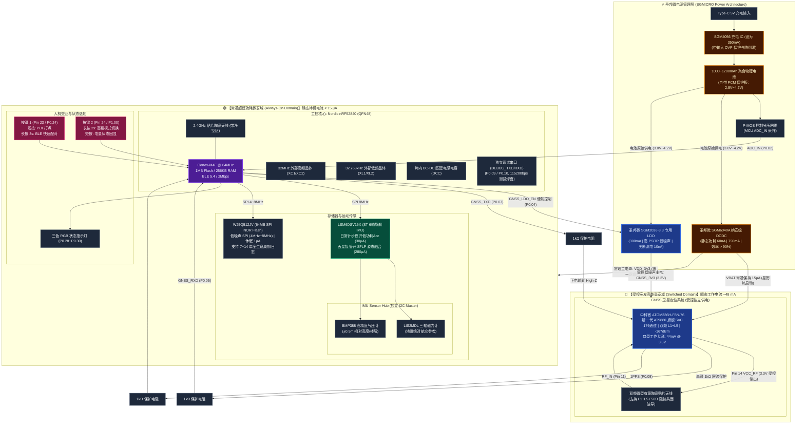
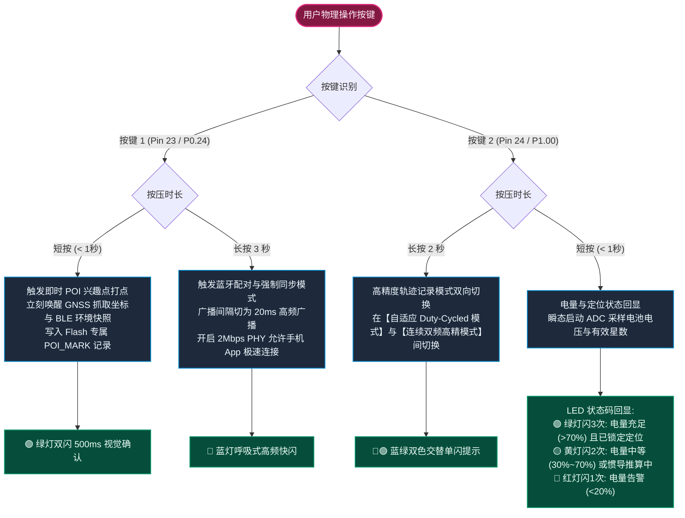
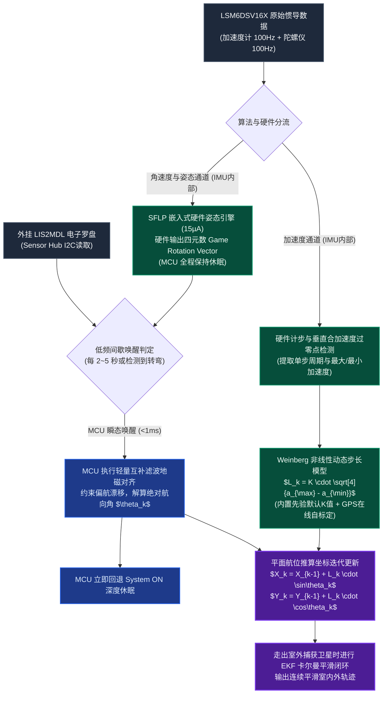
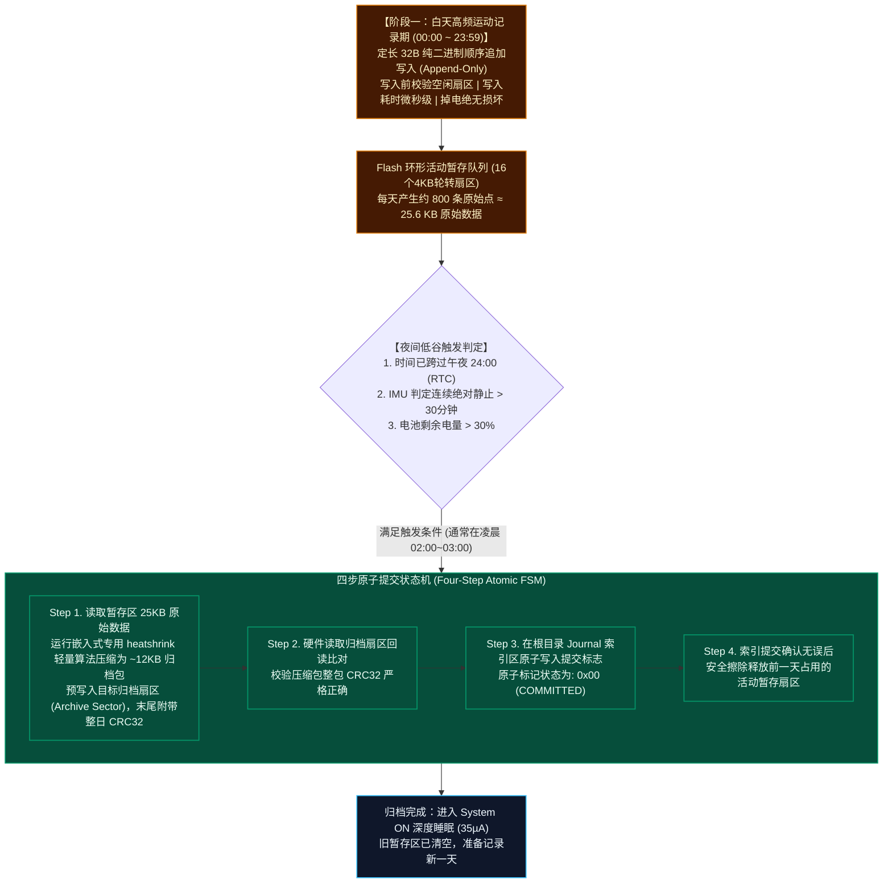

# Life_GPS: 超低功耗全天候 GPS 与惯导(PDR)轨迹记录仪

[](LICENSE)
[-red.svg)](Doc/nRF52840_Product_Specification_v1.11.pdf)
[-green.svg)](Doc/ATGM336H-F8N76_Datasheet.pdf)
[](Doc/LSM6DSV16X_Datasheet.pdf)
[-yellow.svg)](Doc/W25Q512JV_SPI_Flash.pdf)
[-purple.svg)](Doc/README.md)
[](#11-开发路线图-roadmap)

> **⚠️ 工程阶段提示**：本项目目前处于**系统架构设计与硬件方案论证阶段（Pre-Schematic Architecture Phase）**。本文档中所有续航时间、静态功耗与定位精度数据均为基于官方元器件规格书的**理论数学建模与设计目标（Target Spec）**，最终指标以未来打样工程样机的实测测试报告为准。

**Life_GPS** 是一款专为“一生轨迹（Life Trajectory）”全天候记录、户外越野穿越以及数字游民环境感知打造的**超低功耗微型智能记录仪**。

本项目旨在解决智能手机在全天候开启高精度 GPS 和蓝牙后台扫描时面临的**续航断崖式崩塌（几小时耗尽）、发热严重、系统后台频繁杀进程、隐私数据上传云端**等行业痛点。系统采用创新的**“双域物理隔离（Dual-Domain Isolation）”**低功耗硬件架构，结合高能效无线 SoC、中科微新一代双频多模高精度 GNSS、内置边缘算法的 6 轴惯性测量单元（IMU）、全套圣邦微（SGMICRO）纳安级高效电源管理方案，以及**板载 64MB (512Mb) 超大容量 SPI NOR Flash（支持夜间截断压缩归档）**，在配备 **1000mAh ~ 1200mAh** 微型锂电池的物理限制下，实现 **15 至 30 天** 的理论超长待机与**长达 7 至 14 年的全生命周期免擦除一生轨迹存储**。

---

## 目录
- [1. 核心设计亮点与相比手机的优势](#1-核心设计亮点与相比手机的优势)
- [2. 关键元器件选型与原厂真实性能参数](#2-关键元器件选型与原厂真实性能参数)
  - [2.1 主控 SoC：Nordic nRF52840 (QFN48 封装)](#21-主控-socnordic-nrf52840-qfn48-封装)
  - [2.2 ⚠️ nRF52840 QFN48 封装功能限制与硬件避坑重点](#22-️-nrf52840-qfn48-封装功能限制与硬件避坑重点)
  - [2.3 GNSS 卫星定位模组：中科微 ATGM336H-F8N-76 (双频旗舰款)](#23-gnss-卫星定位模组中科微-atgm336h-f8n-76-双频旗舰款)
  - [2.4 6轴惯性测量单元 (IMU)：STMicroelectronics LSM6DSV16X](#24-6轴惯性测量单元-imustmicroelectronics-lsm6dsv16x)
  - [2.5 板载 64MB (512Mb) SPI NOR Flash：Winbond W25Q512JV](#25-板载-64mb-512mb-spi-nor-flashwinbond-w25q512jv)
  - [2.6 全套圣邦微 (SGMICRO) 高效电源管理与保护方案](#26-全套圣邦微-sgmicro-高效电源管理与保护方案)
- [3. 系统硬件架构：双域物理隔离 Mermaid 拓扑图与对比矩阵](#3-系统硬件架构双域物理隔离-mermaid-拓扑图与对比矩阵)
- [4. 双按键多功能交互定义 (蓝牙配对 / POI打点 / 高精度模式)](#4-双按键多功能交互定义-蓝牙配对--poi打点--高精度模式)
- [5. 时钟源、调试串口与引脚分配 (QFN48 真实物理引脚)](#5-时钟源调试串口与引脚分配-qfn48-真实物理引脚)
- [6. 超低功耗动态调度策略与三档自洽数学预算](#6-超低功耗动态调度策略与三档自洽数学预算)
- [7. GPS 丢失后的惯导与 PDR 行人航位推算方案](#7-gps-丢失后的惯导与-pdr-行人航位推算方案)
- [8. 两阶段暂存、夜间压缩归档与数据主权静态加密](#8-两阶段暂存夜间压缩归档与数据主权静态加密)
  - [8.1 蓝牙环境感知与隐私合规 (散列化防追踪)](#81-蓝牙环境感知与隐私合规-散列化防追踪)
  - [8.2 严格 32 字节紧凑对齐数据结构 (Life_GPS 2020 Epoch)](#82-严格-32-字节紧凑对齐数据结构-life_gps-2020-epoch)
  - [8.3 两阶段暂存、扇区磨损均衡与夜间截断压缩归档机制](#83-两阶段暂存扇区磨损均衡与夜间截断压缩归档机制)
  - [8.4 基于 CryptoCell-310 的板载 Flash 静态硬件流加密](#84-基于-cryptocell-310-的板载-flash-静态硬件流加密)
- [9. 无屏幕状态交互与日志调试通道](#9-无屏幕状态交互与日志调试通道)
- [10. 项目工程结构与设计资料索引](#10-项目工程结构与设计资料索引)
- [11. 开发路线图 (Roadmap)](#11-开发路线图-roadmap)

---

## 1. 核心设计亮点与相比手机的优势

| 评估维度 | 智能手机 (App 后台记录) | Life_GPS 专用记录仪 (设计目标) | 核心技术优势剖析 |
| :--- | :--- | :--- | :--- |
| **全天工作续航** | 开启高精度定位+蓝牙扫描仅支撑 **4 ~ 8 小时** | 1000mAh 电池目标续航 **15 ~ 30 天**（一次充电支持整月记录） | 专用超低功耗架构，无屏幕、无安卓/iOS高负荷操作系统底噪 |
| **生命周期存储** | 手机内部日志零散膨胀，受限于系统缓存清理 | **板载 64MB 超大 NOR Flash**，夜间自动截断压缩归档 | 32B 定长紧凑结构体，单颗芯片直接封存 **7 ~ 14 年全生命周期轨迹** |
| **电源转换能效** | 手机内部多路电源转换复杂，发热严重 | **圣邦微 SGM6040A 纳安级 DCDC**（60nA静态电流，750mA输出能力） | 告别传统线性 LDO 在 4.2V 下浪费 22% 压差发热的弊端 |
| **系统稳定性** | 操作系统频繁杀后台、省电策略干预导致断轨、丢点 | 专用 RTOS 固件驱动，硬件看门狗保障，**全天候永不断轨** | 硬件级连续守护，状态机自闭环 |
| **遮挡与丢星处理**| 室内、地下商场直接失去定位或发生数百米跳变漂移 | **LSM6DSV16X 硬件融合 + PDR 航位推算**（刚性佩戴下接管） | 基于步长自适应模型与四元数航向，低频地磁融合约束发散，推算误差受控可预测 |
| **环境感知能力** | 手机系统出于权限与隐私严格封锁底层 BLE 原始广播 | 全频段微占空比扫描，抓取周边固定 Beacon 基站短 ID 与 RSSI | 形成包含“地理位置 + 空间射频环境”的多维离线环境时空轨迹 |
| **设备体积与便携性**| 笨重、发热严重、需随身携带充电宝 | 仅钥匙扣/卡片尺寸（约 52×36×9mm），整机重量 < 35g，随身挂载 | 适合腰带夹固定、背包外侧挂载或放置于车钥匙扣上 |
| **数据安全性与隐私**| 轨迹频繁实时上传云端，面临第三方追踪与商业分析 | **纯离线存储于板载 NOR Flash**，仅由用户物理导出或自主同步 | 真正的数据主权归属个人，物理隔离离线“一生轨迹”底库 |

---

## 2. 关键元器件选型与原厂真实性能参数

### 2.1 主控 SoC：Nordic nRF52840 (QFN48 封装)
* **核心架构**：ARM Cortex-M4F @ 64MHz，集成硬件浮点运算单元（FPU）与专用 DSP 指令集。
* **存储容量**：**1MB 片上 Flash + 256KB RAM**。彻底规避低端芯片（如 nRF52810）RAM 匮乏且官方协议栈阉割“蓝牙扫描（Observer）”的致命缺陷，有充裕内存容纳蓝牙扫描哈希表、RTOS 任务栈及夜间轻量压缩缓冲区。
* **封装优势（QFN48）**：相较于 73 引脚 aQFN 封装，QFN48 拥有 0.4mm 间距的标准四边扁平引脚，PCB 扇出（Fan-out）极为简单，4 层乃至 2 层板即可轻松布通，极大降低打样制板与 SMT 贴片门槛。
* **无线特性**：支持 Bluetooth 5.4、Coded PHY（Long Range 长距离模式）、2Mbps 高速传输。

---

### 2.2 ⚠️ nRF52840 QFN48 封装功能限制与硬件避坑重点
根据 Nordic 官方《nRF52840 Product Specification》（文档第 7.1.2 节及引脚分配表），**QFN48 封装相比标准 aQFN73 封装在硬件功能上有严格的物理级精简**，在原理图和硬件设计中必须重点避坑：

1. **缺失原生 USB 硬件引脚（无 VBUS、D+、D-）**：
   * **原厂物理事实**：QFN48 封装的 48 个引脚中**根本没有引出 VBUS、USB D+ 和 USB D- 管脚**（仅 aQFN73 具备）。
   * **设计对策**：板载 Type-C 接口专用于 5V 锂电池充电输入；日常数据导出主要采用 **BLE 5.0 (2Mbps PHY) 高速无线同步**；同时系统在空闲 GPIO 上**引出了专用的独立硬件调试串口（DEBUG_UART: TXD/RXD）测试焊盘**，用于连接外部 USB-TTL 串口板输出固件实时 Log。
2. **高压供电模式（High Voltage Supply Mode，REG0）内部短接失效**：
   * **原厂规格书明文**：*“Note: VDD and VDDH are shortcircuited inside the package. Therefore the device is only usable in Normal Voltage supply mode, and not High Voltage supply mode.”*
   * **设计对策**：**严禁将单节锂电池（3.7V~4.2V）或 USB 5V 直接接给 nRF52840 芯片电源管脚**！系统必须由圣邦微 SGM6040A 降压 DCDC 将电池电压高效转换为 3.3V 后输入 VDD，工作在 Normal Voltage Supply Mode（1.7V~3.6V）。
3. **真实可用 GPIO 数量精简至 30 个**：
   * aQFN73 引出 48 个 GPIO，而 QFN48 **引出 30 个有效 GPIO**：
     * P0 端口保留 26 个管脚（标准 32 个中**仅缺失 P0.06、P0.15、P0.16、P0.25、P0.26、P0.27 共 6 个管脚**，即 $32 - 6 = 26$）；
     * P1 端口大部分被裁剪，**仅引出 P1.00、P1.08、P1.09、P1.15 四个管脚**。
   * **合计可用 GPIO 为 $26 + 4 = 30$ 个**。
   * **设计对策**：本工程已严格基于 QFN48 的真实 30 个物理有效 GPIO 管脚编排所有外设总线，杜绝任何不存在引脚的连线错误。
4. **外部时钟晶振引脚规划与负载电容规范**：
   * 必须在专用管脚 `XC1 (Pin 35)` 和 `XC2 (Pin 36)` 外挂 **32MHz 高频石英晶体（HFXO）**，这是 2.4GHz BLE 射频与 64MHz 主频运行的必需时基。晶体标称负载电容取 $C_L = 12\text{ pF}$，外挂对称匹配电容设计为 $C_1 = C_2 = 2 \times (C_L - C_{stray}) \approx 18\text{ pF}$（PCB 杂散容抗 $C_{stray} \approx 3\text{ pF}$）；
   * 必须在 `P0.00/XL1 (Pin 2)` 和 `P0.01/XL2 (Pin 3)` 外挂 **32.768kHz 低频石英晶体（LFXO）**，匹配标称 $C_L = 9\text{pF}$ 或 $12.5\text{pF}$ 晶体，为睡眠状态下的 RTC 提供微安级超低功耗时基。

---

### 2.3 GNSS 卫星定位模组：中科微 ATGM336H-F8N-76 (双频旗舰款)
> **权威规格依据与来源声明**：依据中科微原厂官方《ATGM336H-F8N 模块用户手册》，本型号为中科微新一代基于 **AT9880 旗舰 SoC 架构** 的**全系统多频点（双频 L1+L5）高性能 GNSS 定位导航与高精度授时模组**。
> *(注：-167dBm 跟踪灵敏度与最高 20Hz 更新率为模组产品手册给出的最佳工况标称值；底层 AT9880 单芯片规格书基础指标为 -162dBm 跟踪灵敏度与 10Hz 常规更新率。在实际固件部署中，自适应模式以 1Hz 快照为主，高精模式以 5Hz 连续解算为主，兼顾精度与功耗平衡)*：

| 关键参数项目 | 官方规格书真实数据 | 详细特性与工程说明 |
| :--- | :--- | :--- |
| **具体订货型号** | **ATGM336H-F8N-76** | 全模多频版本（区别于单北斗专用的 AT9880B 系列），集成片上 Flash |
| **核心 SoC 芯片** | **中科微新一代 AT9880** | 多频多系统 GNSS SoC 单芯片，集成高性能嵌入式 CPU |
| **支持卫星频点** | **L1 + L2/L5 多频点** | **BDS (B1I+B1C+B2a/B2b), GPS (L1+L2/L5), GALILEO (E1+E5a/E5b), GLONASS (L1), IRNSS (L5), QZSS, SBAS** |
| **物理跟踪通道** | **176 通道** | 可同时跟踪多星座数十颗有效卫星，具备极强电离层延迟消除与多径抑制能力 |
| **跟踪灵敏度** | **-167 dBm** (模组标称) | 处于行业顶级水准（冷启动捕获 -148dBm，热启动捕获 -156dBm，重捕获 -160dBm；SoC基础标称 -162dBm） |
| **定位 / 测速精度** | **< 1.0 m (CEP50)** / **< 0.1 m/s (1σ)** | 优于传统单频模块 2.5m 精度，城市峡谷与林荫道定位更平滑 |
| **启动时间 (TTFF)** | 冷启动 $\le 30\text{ s}$，**热启动 $\le 1\text{ s}$**，重捕获 $\le 1\text{ s}$ | 具备后备电源 VBAT 时，重新通电瞬间实现秒定 |
| **最大定位更新率** | **最高 20 Hz** (默认 1Hz / 固件高精5Hz) | 满足户外冲刺、运动竞技及高精度赛段轨迹记录需求 |
| **串口通信特性** | **默认 115200 bps**，8-N-1 | 相比老款 9600bps 提速 12 倍，大幅缩短数据吐出时间，帮助 MCU 提早休眠 |
| **运行功耗参数** | **典型电流 44 mA @ 3.3V** (L1+L5双频满载) | 待机功耗 **< 20 µA**，RTC后备电源 VBAT 供电电流仅 **15 µA** (每日约 0.36 mAh) |
| **独立供电架构** | **圣邦微 SGM2036-3.3 专用 LDO 供电** | **带 EN 使能脚硬切断（关断漏电仅 10nA）**，低噪声高 PSRR 隔绝电源杂波 |
| **射频前端天线方案** | 采用微型**双频有源陶瓷贴片天线** | 模块内部已集成 LNA 与滤波器，直接由模组 Pin 14 `VCC_RF` 输出受控供电，随模组上下电，**废除单频专用的 MAX2659** |
| **防倒灌硬件设计** | 信号线串联 1kΩ 隔离电阻 | `TXD`、`RXD`、`PPS` 线上串接 1kΩ 电阻，下电时 MCU IO 置浮空 (High-Z)，杜绝通过 ESD 二极管倒灌偷电 |

#### GNSS 核心工程设计要点与能效权衡：
1. **供电架构权衡 (LDO vs Buck Trade-off)**：
   * SGM2036 线性 LDO 压降效率为 $\eta = 3.3\text{V} / V_{bat} \approx 78.6\% \sim 89.2\%$。在 44mA 满载下，电池端放电电流等同于 44mA，纯压差发热功率约为 $(3.8\text{V} - 3.3\text{V}) \times 44\text{mA} \approx 22\text{mW}$（满电 4.2V 时近 40mW）；相比开关 Buck（按 90% 效率折算电池端约 36mA），LDO 每天在 GNSS 脉冲期多损耗约 2.5~3.0mAh 电量（约占总预算 7%~9%）。
   * **采纳专路 LDO 的核心理由**：在 52×36mm 的极小密闭外壳内，GNSS 接收天线对微弱卫星信号（-167dBm）极度敏感。开关 Buck 的功率电感漏磁与高频开关纹波（百 kHz 至数 MHz）极易通过地平面和近场耦合串入双频 L1/L5 射频前端，引起严重的载噪比（C/N0）跌落与丢星。因此工程上**坚决以牺牲约 8%~10% 的每日续航为代价，换取极度洁净的射频底噪与零外置功率电感空间**。同时在 Roadmap 中作为 V2 储备方案规划“微型 Buck 预降至 3.45V + 后级超低压差 LDO 至 3.3V”的二级供电拓扑。
2. **固件级 NMEA 极速裁剪节能**：
   * 模组出厂默认输出全套 NMEA 报文（GGA、GSA、GSV×4、RMC、VTG、GLL 等），单 epoch 数据量达 1.2~1.8KB，在 115200bps 下传输需 100~150ms；
   * 本固件在每次快照唤醒模组后，通过专有 CASIC 指令关闭其余所有语句，**仅使能 `$GNRMC` 与 `$GNGGA`（单次约 200 字节，传输耗时压缩至 < 18ms）**。在每天约 800 次脉冲快照下，累计缩短 MCU 串口 DMA 接收等待与模组吐字时间，每日纯省约 **1.5 mAh** 宝贵电量。
3. **射频前端双频匹配与外置 LNA 避坑**：
   * 传统 GPS 方案常用的 **MAX2659 为单频 L1 (1575.42MHz) 专用 LNA**，对北斗/GPS 的 L5 (1176.45MHz) 频段衰减严重，严禁用于本双频系统；
   * ATGM336H-F8N 模块内部已自带双频 LNA 与 SAW 预滤波网络，外部射频接口直连微型双频陶瓷天线，天线有源供电由模组 Pin 14 `VCC_RF` 受控输出（3.3V / 50mA 带短路保护）；若原理图外加一级 LNA，必须选型专用双频芯片（如 BGM13G）并严格核算输入 1dB 压缩点（P1dB），防止强信号下前端饱和。

---

### 2.4 6轴惯性测量单元 (IMU)：STMicroelectronics LSM6DSV16X
* **传感器规格**：3 轴数字加速度计（±2g 至 ±16g） + 3 轴数字陀螺仪（±125 至 ±4000 dps）。
* **功耗分级管理（实事求是）**：
  * **日常计步状态**：仅开启低功耗加速度计，电流仅 **$\approx 30\text{ }\mu\text{A}$**；
  * **PDR 惯导接管状态**：全开加速度计 + 陀螺仪 + SFLP 姿态融合，低功耗 Combo 模式下电流为 **$280\text{ }\mu\text{A} \sim 400\text{ }\mu\text{A}$**（SFLP 协处理器单元本身增量仅 15µA）；
* **嵌入式边缘智能三核架构**：
  1. **MLC (Machine Learning Core)**：硬件级机器学习决策树，实时识别静止、步行、慢跑、乘车（Vehicle）等活动模式；
  2. **FSM (Finite State Machine)**：8 个独立可编程有限状态机，负责瞬态动作提取与手势监测；
  3. **SFLP (Sensor Fusion Low Power)**：嵌入式超低功耗传感器融合算法引擎，硬件输出 6 轴姿态四元数（Game Rotation Vector）。
* **扩展能力 (Sensor Hub)**：具备独立 I2C Master，可直接外挂三轴磁力计（**LIS2MDL**）与高精度气压计（**BMP388**），数据统一打包进内部 FIFO，免去频繁唤醒主控 CPU。
* **触摸感知**：具备 **Qvar** 静电电荷变化检测通道，支持设备外壳轻击、滑动手势及人体穿戴检测。

---

### 2.5 板载 64MB (512Mb) SPI NOR Flash：Winbond W25Q512JV
为实现**“存储整机物理生命周期一生轨迹”**的核心愿景，系统将板载存储升级为华邦工业级 64MB SPI NOR Flash：
* **芯片型号**：Winbond **W25Q512JVEIQ**（512M-bit / 64 Mega-bytes，WSON-8 6×8mm 紧凑封装）；
* **物理可靠性对比优势**：
  * 相比 SPI NAND Flash，NOR 架构**出厂零坏块、无坏块管理（BBM）与 ECC 纠错负担**，支持标准 256 字节页编程与 4KB 扇区擦除；
  * 深度休眠漏电极低（典型值仅 **$1\text{ }\mu\text{A}$**，不拖累系统待机底噪）；
  * 具备 **100,000 次（十万次）擦写寿命** 与 **20 年数据保持期**；
* **低噪声总线规划**：SPI 通信速率配置为 **4MHz ~ 8MHz**，既满足微秒级日志写入，又彻底消除 32MHz 高次谐波对卫星天线 L1/L5 的高频射频干扰；
* **生命周期容量测算**：单条记录 32 字节，每天运动 10 小时产生约 800 条点（约 25.6KB/天）。**64MB 空间在完全不压缩的情况下足以连续记录 7 年（约 2500 天）；配合夜间轻量压缩，足以连续存储 14 年以上！**

---

### 2.6 全套圣邦微 (SGMICRO) 高效电源管理与保护方案
为兼顾极致续航、高电源抑制比（PSRR）、严格热控制与完全自主可控供应链，本项目电源部分全部采用**圣邦微电子（SGMICRO）**成熟物料并匹配严谨的锂电与接口防护：

1. **主控系统降压 DCDC：圣邦微 SGM6040A**
   * **纳安级超低静态电流**：静态待机电流低至 **60 nA**（0.06 µA），关断电流典型仅 **25 nA**；
   * **微载荷极限效率**：在 $1\text{ }\mu\text{A}$ 微载荷输出下效率依然高达 **80%**，重载峰值效率超过 **90%**；
   * **输出能力与特性**：输入 1.8V ~ 5.5V，最大输出电流 **750 mA**；通过 VSET 引脚单颗精密电阻配置为 **固定 3.3V 输出**；具备 100% 占空比旁路模式（Bypass 模式下 $I_Q$ 仅 120nA）；
   * **STOP 硬件低噪引脚**：具备 STOP 硬件控制脚，在 MCU 执行高灵敏度 ADC 采样时可瞬态冻结开关动作消除开关噪声。
2. **GNSS 独立低噪声 LDO：圣邦微 SGM2036-3.3**
   * **专路专供**：ATGM336H-F8N-76 射频定位模组工作电流大（44mA）且对电源纹波极度敏感。SGM2036 提供高达 300mA 洁净低纹波电源，彻底杜绝 DCDC 开关纹波串入卫星天线前端；
   * **受控物理切断**：具备逻辑使能脚（EN），由 nRF52840 GPIO `P0.04` 控制。休眠时拉低 EN，**关断漏电流仅 10 nA**，实现零漏电硬隔离。
3. **锂电池充电管理：圣邦微 SGM4056 (严控发热与温度保护)**
   * **IC 定位与充电参数**：1A 线性锂电池充电芯片，集成高达 26.5V 输入耐压与过压保护（OVP 6.8V），防电池倒灌漏电 $< 1\text{ }\mu\text{A}$，具备 CHRG/STDBY 充电状态指示；
   * **充电电流硬件限额（0.35C 控温）**：SGM4056 为线性降压充电，压差功耗为 $(V_{bus} - V_{bat}) \times I_{chrg}$。若按默认 1A 充电，在 52×36mm 微型密封外壳内发热功率将高达 $(5.0 - 3.7)\text{V} \times 1\text{A} = 1.3\text{W}$，会导致电芯严重温升。因此本设计将 PROG 引脚电阻设定为 **$R_{PROG} = 2.8\text{ k}\Omega$**，将恒流充电严格限制在 **350 mA（0.35C）**，最大发热压差功耗仅约 **0.45W**，温升极低且兼顾充饱速度（约 3 小时满电）；
   * **温度监测保护 (NTC / JEITA)**：选用带 TEMP 引脚的 SGM4056 封装（如 TDFN-3×3-8L），外接电芯内置 NTC 热敏电阻，硬件与固件遵循 JEITA 规范，在电池温度 $<0^\circ\text{C}$ 或 $>45^\circ\text{C}$ 时自动暂停充电。
4. **锂电芯硬件保护板回路 (PCM 兜底防过放)**：
   * SGM4056 仅负责充电过程管理，**本身不具备电池过放与短路保护功能**；
   * 本工程规定必须采用**自带保护板（集成专用保护 IC 如 DW01A / AP9101C + 8205A 复合双 N-MOS）的 1000mAh~1200mAh 聚合物电芯**，提供 **3.0V 硬件级过放切断保护**、4.28V 过充硬件保护及 2.5A 短路锁死机制，彻底消除长期密封存放导致电芯过放鼓包与损坏风险。
5. **接口与天线 ESD / TVS 硬件防护**：
   * **Type-C 输入端口**：钥匙扣设备常伴随人体摩擦与频繁插拔，Type-C 的 VBUS 5V 输入与 CC1/CC2 引脚配置 **USBLC6-2SC6 超低结容 TVS 保护阵列**，耐受 IEC 61000-4-2 $\pm 15\text{kV}$ 空气放电与 $\pm 8\text{kV}$ 接触放电；
   * **GNSS 射频天线端口**：天线 RF 输入端串入微型超低结容（$C_J < 0.2\text{ pF}$）双向射频 ESD 保护二极管（如 ESD9R3.3ST5G），在不衰减 L1/L5 射频信号的前提下杜绝人体触摸静电击穿模组 LNA。

---

## 3. 系统硬件架构：双域物理隔离 Mermaid 拓扑图与对比矩阵

### 3.1 系统双域架构 Mermaid 流程图



### 3.2 供电与功耗域对比矩阵 (Domain Contrast Matrix)

| 架构对比维度 | 🟢 常通超低功耗微安域 (Always-On Domain) | 🔵 受控突发高能毫安域 (Switched GNSS Domain) |
| :--- | :--- | :--- |
| **所属核心硬件** | **nRF52840 SoC、LSM6DSV16X IMU、W25Q512JV (64MB NOR)** | **ATGM336H-F8N-76 GNSS 模组、双频有源陶瓷天线** |
| **独立供电通道** | **圣邦微 SGM6040A 纳安级 DCDC** (静态电流 60nA, 750mA 输出) | **圣邦微 SGM2036-3.3 专用受控 LDO** (300mA, 高 PSRR, 低噪声) |
| **工作电压基准** | **全板统一 3.3V** (输入跌破 3.3V 时自动 100% Bypass 直通) | **严格受控 3.3V** (消除数字信号线电平倒灌与超限风险) |
| **供电控制机制** | 全天候常通供电，维持系统时基与状态监听 | **通过 MCU GPIO `P0.04` 控制 SGM2036 的 EN 脚**实现硬件级通断 |
| **静态休眠电流** | **$35\text{ }\mu\text{A} \sim 45\text{ }\mu\text{A}$** (System ON + RTC + IMU低功耗 + Flash深休眠 + GNSS VBAT) | **$< 0.01\text{ }\mu\text{A}$** (SGM2036 关断漏电仅 10nA，彻底消除静电漏电) |
| **动态运行电流** | $0.65\text{ mA} \sim 8\text{ mA}$ (BLE 广播/扫描/姿态运算) | **$44\text{ mA} \sim 48\text{ mA}$** (双频 176 通道满载搜星 + 有源天线) |
| **运行占空比** | 100% 全天候在线守护 | 脉冲式快照工作（常规运动下仅占空约 **4% ~ 10%**） |
| **后备保活设计** | 主控保持高精度时间戳与事件哈希表 | 模组 `VBAT` 引脚接常通 3.3V (15µA)，保证 RTC/SRAM 热启动秒定 |

---

## 4. 双按键多功能交互定义 (蓝牙配对 / POI打点 / 高精度模式)

设备采用无屏幕超薄设计，为了提供强大且直观的操作体验，硬件配备了 **2 个独立多功能轻触按键**，覆盖了日常使用、兴趣点记录与特殊工况切换三大场景：

### 4.1 双按键操作逻辑流程图 (Mermaid)



---

## 5. 时钟源、调试串口与引脚分配 (QFN48 真实物理引脚)

### 5.1 外部高低频时钟源规划与标准负载容抗
* **32MHz 外部高频晶振 (HFXO)**：接至专用管脚 `XC1 (Pin 35)` 和 `XC2 (Pin 36)`。晶体标称负载电容 $C_L = 12\text{ pF}$，外挂对称匹配电容设计为 $C_1 = C_2 = 2 \times (C_L - C_{stray}) \approx 18\text{ pF}$（PCB 杂散容抗 $C_{stray} \approx 3\text{ pF}$），频差 $\le \pm 10\text{ ppm}$，为 2.4GHz BLE 射频与 64MHz CPU 提供精准时基；
* **32.768kHz 外部低频晶振 (LFXO)**：接至专用管脚 `P0.00/XL1 (Pin 2)` 和 `P0.01/XL2 (Pin 3)`，晶体标称 $C_L = 9\text{ pF}$ 或 $12.5\text{ pF}$，外挂匹配电容依晶体手册取 15pF~22pF，为睡眠 RTC 计时提供微安级时基。

### 5.2 独立预留硬件调试串口 (DEBUG_UART)
为满足开发过程中的日志捕获与固件调试，系统分配了独立于 GNSS 的硬件调试串口：
* **`DEBUG_TXD`**：分配至 `P0.09` (Pin 29)，引出板载测试焊盘 (TP)，波特率 115200bps，输出实时系统 Log；
* **`DEBUG_RXD`**：分配至 `P0.10` (Pin 30)，引出板载测试焊盘 (TP)，用于接收配置调试指令；
* *注：P0.09/P0.10 默认具 NFC 保护电容，在固件 UICR 配置中必须配置 `NFCPINS = 0`，以释放为标准数字 GPIO。*

### 5.3 nRF52840 QFN48 完整物理引脚分配映射表
系统完全基于 QFN48 真实的 **30 个有效物理 GPIO** 规划（P0 端口 26 个 + P1 端口 4 个，无任何不存在管脚）：

| 物理管脚编号 | 端口网络标号 | I/O方向 | 硬件连接与电气功能描述 |
| :--- | :--- | :---: | :--- |
| **Pin 35 / Pin 36**| `XC1 / XC2` | IN/OUT | **32MHz 外部高频石英晶体 (HFXO)**，BLE 射频与 CPU 必需基准 |
| **Pin 2 / P0.00** | `RTC_XTAL_IN (XL1)` | IN | **32.768 kHz 外部低频晶体 (LFXO)** 输入端，微安待机时基 |
| **Pin 3 / P0.01** | `RTC_XTAL_OUT (XL2)`| OUT | **32.768 kHz 外部低频晶体 (LFXO)** 输出端 |
| **Pin 40 / P0.02** | `BAT_ADC_IN (AIN0)` | IN | 电池电压分压采集模拟输入（Standard Drive，低频） |
| **Pin 39 / P0.03** | `BAT_ADC_EN (AIN1)` | OUT | 电池分压回路使能控制（平时高电平截止，采样时拉低导通 P-MOS） |
| **Pin 4 / P0.04** | `GNSS_LDO_EN` | OUT | **控制圣邦微 SGM2036 LDO 的 EN 脚**（高电平通电，低电平硬切断） |
| **Pin 5 / P0.05** | `GNSS_RXD` | IN | UART 接收引脚（串联 1kΩ 限流电阻连 ATGM336H TXD0，波特率 115200） |
| **Pin 6 / P0.07** | `GNSS_TXD` | OUT | UART 发送引脚（串联 1kΩ 限流电阻连 ATGM336H RXD0，替代不存在的 P0.06） |
| **Pin 7 / P0.08** | `GNSS_PPS` | IN | 接收 ATGM336H 1PPS 授时脉冲（串联 1kΩ 电阻；**GPIOTE 事件经 PPI 直连 TIMER0 捕获寄存器，16MHz 下 62.5ns 分辨率百纳秒硬件授时对齐**） |
| **Pin 29 / P0.09** | `DEBUG_TXD` | OUT | **独立调试串口 TX**（115200bps，引出测试焊盘，UICR配置NFCPINS=0） |
| **Pin 30 / P0.10** | `DEBUG_RXD` | IN | **独立调试串口 RX**（引出测试焊盘，UICR配置NFCPINS=0） |
| **Pin 10 / P0.11** | `IMU_CS` | OUT | LSM6DSV16X SPI 片选引脚（Active Low） |
| **Pin 11 / P0.12** | `IMU_SCK` | OUT | LSM6DSV16X SPI 时钟信号（最高支持 8MHz） |
| **Pin 13 / P0.13** | `IMU_MISO` | IN | LSM6DSV16X SPI 主机输入引脚 |
| **Pin 14 / P0.14** | `IMU_MOSI` | OUT | LSM6DSV16X SPI 主机输出引脚 |
| **Pin 15 / P0.17** | `IMU_INT1` | IN | LSM6DSV16X 中断 1（静止休眠唤醒、计步事件中断） |
| **Pin 8 / P1.08** | `IMU_INT2` | IN | LSM6DSV16X 中断 2（FIFO 阈值满中断、MLC 运动模式识别） |
| **Pin 9 / P1.09** | `FLASH_CS` | OUT | W25Q512JV 64MB Flash 片选引脚（Active Low） |
| **Pin 18 / P0.19** | `FLASH_SCK` | OUT | Flash 时钟信号（具备 QSPI/SCK 硬件驱动能力，配置为 4~8MHz） |
| **Pin 19 / P0.20** | `FLASH_MOSI` | OUT | Flash 数据输入引脚 (SPI MOSI / QSPI IO0) |
| **Pin 20 / P0.21** | `FLASH_MISO` | IN | Flash 数据输出引脚 (SPI MISO / QSPI IO1) |
| **Pin 21 / P0.22** | `FLASH_WP` | OUT | Flash 写保护控制 (QSPI IO2) |
| **Pin 22 / P0.23** | `FLASH_HOLD` | OUT | Flash 保持控制 (QSPI IO3) |
| **Pin 16 / P0.18** | `SYS_RESET` | IN | 硬件复位引脚 / SWD 调试复位 |
| **Pin 26 / Pin 27**| `SWDIO / SWDCLK` | I/O | SWD 固件烧录与在线仿真调试接口 |
| **Pin 23 / P0.24** | `KEY1_PAIR_POI` | IN | **多功能按键 1**（短按：POI 打点；长按 3s：蓝牙配对与同步） |
| **Pin 24 / P1.00** | `KEY2_MODE_ST` | IN | **多功能按键 2**（长按 2s：高精模式切换；短按：电量状态回显） |
| **Pin 41 / P0.28** | `LED_RED` | OUT | 系统状态红灯（低电平点亮/PWM，错误或低电量提示） |
| **Pin 42 / P0.29** | `LED_GREEN` | OUT | 系统状态绿灯（GNSS 定位成功与 POI 打点确认） |
| **Pin 43 / P0.30** | `LED_BLUE` | OUT | 系统状态蓝灯（BLE 广播配对与数据传输中） |
| **Pin 38 / P1.15** | `RESERVED` | - | 预留备用 GPIO |
| **Pin 44 / P0.31** | `RESERVED` | - | 预留外部扩展测试点 |

> **物理可用 GPIO 数量精确核验**：
> - **P0 端口（26 个）**：P0.00, P0.01, P0.02, P0.03, P0.04, P0.05, P0.07, P0.08, P0.09, P0.10, P0.11, P0.12, P0.13, P0.14, P0.17, P0.18, P0.19, P0.20, P0.21, P0.22, P0.23, P0.24, P0.28, P0.29, P0.30, P0.31（P0 仅缺失 P0.06、P0.15、P0.16、P0.25、P0.26、P0.27 共 6 个管脚，即 $32 - 6 = 26$ 个）；
> - **P1 端口（4 个）**：P1.00, P1.08, P1.09, P1.15；
> - **合计可用物理 GPIO**：$26 + 4 = \mathbf{30}\text{ 个}$，完全匹配硬件设计与总线规划。

---

## 6. 超低功耗动态调度策略与三档自洽数学预算

### 6.1 记录模式特性对比 (Mode Contrast Matrix)

| 模式对比维度 | 模式 A：超低功耗自适应模式 (默认) | 模式 B：高精度连续记录模式 (按键2切换) |
| :--- | :--- | :--- |
| **主要定位方式** | 微占空比周期性定位 (Duty-Cycled GNSS) | 连续高频双频卫星跟踪 + 高频惯导融合 |
| **GNSS 供电与占空比** | **4% ~ 10%** (SGM2036 脉冲式通电 2~4 秒锁定即切断) | **100% 常开运行** (SGM2036 持续输出洁净电源) |
| **定位更新频率** | 动态自适应心跳 (静止关闭，行走 45~60s 一次) | **1 Hz ~ 5 Hz 连续输出** (最高支持 20Hz) |
| **电源转换能效** | SGM6040A 静态功耗仅 60nA，轻载效率 80%，重载 >90% | DCDC 持续高效降压转换，杜绝线性压差发热 |
| **适用场景** | 日常生活记录、城市通勤、多日户外徒步 | 越野赛道跑、山地骑行攻顶、复杂弯道精准打点 |
| **电池端平均放电电流**| **$\approx 0.86\text{ mA} \sim 1.62\text{ mA}$** (典型值约 1.62mA) | **$\approx 48\text{ mA} \sim 50\text{ mA}$** (GNSS 44mA + MCU/IMU/损耗) |
| **1000mAh 电池续航** | **理论设计目标：15 ~ 43 天** (典型工况约 23.2 天) | **理论设计目标：$\approx 18.0\text{ 小时}$** (满足专业赛事单日全开) |

---

### 6.2 默认自适应模式的三档情景自洽功耗数学模型
*以 1000mAh 聚合物电池（扣除化学老化、月自放电与低温衰减，按 **900 mAh 真实有效可用电量** 计算；每日设定为 14 小时静止睡眠待机 + 10 小时户外/通勤运动）：*

> **900 mAh 有效可用电量扣减依据**：
> 1. **锂电池常温自放电**：扣除约 2%~3% / 月的电化学自放电损失（折合约 20~30 mAh）；
> 2. **截止电压与转换开销**：PCM 保护板 3.0V 截止与 SGM6040A 压差留存（约 30~40 mAh）；
> 3. **户外低温环境折减**：户外 0℃~10℃ 环境下电化学活性衰减冗余（约 30~40 mAh）。

| 功耗组成单元 | 🟢 乐观情景 (空旷郊外/星历极佳) | 🟡 典型情景 (城市开阔/步行通勤) | 🔴 悲观情景 (高楼峡谷/频繁丢星) |
| :--- | :--- | :--- | :--- |
| **单次锁星出 Fix 耗时** | **2.5 秒** (极速热启动，0次超时) | **3.5 秒** (基准热启动，含遮挡) | **6.0 秒** (弱信号搜星，多遮挡) |
| **采样周期** | 每 60 秒快照一次 (600次/天) | 每 45 秒快照一次 (800次/天) | 每 45 秒快照一次 (800次/天) |
| **正常快照工作占空比** | **4.17%** | **7.78%** | **13.33%** |
| **1. GNSS 正常脉冲定位能耗** | $44\text{mA} \times 4.17\% \times 10\text{h} = \mathbf{18.33\text{ mAh}}$ | $44\text{mA} \times 7.78\% \times 10\text{h} = \mathbf{34.22\text{ mAh}}$ | $44\text{mA} \times 13.33\% \times 10\text{h} = \mathbf{58.67\text{ mAh}}$ |
| **2. 丢星超时搜星惩罚项** | **0 次** 超时惩罚: $\mathbf{0.00\text{ mAh}}$ | **5 次** 15s 超时探查: $\mathbf{0.92\text{ mAh}}$ | **12 次** 15s 超时探查: $\mathbf{2.20\text{ mAh}}$ |
| **3. GNSS VBAT 常通保持** | $15\mu\text{A} \times 24\text{h} = \mathbf{0.36\text{ mAh}}$ | $15\mu\text{A} \times 24\text{h} = \mathbf{0.36\text{ mAh}}$ | $15\mu\text{A} \times 24\text{h} = \mathbf{0.36\text{ mAh}}$ |
| **4. 静止待机 (14h, 常通域底噪)**| $35\mu\text{A} \times 14\text{h} = \mathbf{0.49\text{ mAh}}$ | $35\mu\text{A} \times 14\text{h} = \mathbf{0.49\text{ mAh}}$ | $40\mu\text{A} \times 14\text{h} = \mathbf{0.56\text{ mAh}}$ |
| **5. IMU 计步与 PDR 磁融合** | 纯加速度计低功耗: $\mathbf{0.30\text{ mAh}}$ | 偶发 PDR+低频磁融合: $\mathbf{1.20\text{ mAh}}$ | 频繁室内长程 PDR: $\mathbf{3.00\text{ mAh}}$ |
| **6. BLE 扫描与存储归档** | 极低占空比追加: $\mathbf{1.20\text{ mAh}}$ | 典型扫描+夜间归档: $\mathbf{1.60\text{ mAh}}$ | 高密度射频指纹写入: $\mathbf{2.20\text{ mAh}}$ |
| **每日总耗电量估算** | **$\mathbf{20.68\text{ mAh / 天}}$** | **$\mathbf{38.79\text{ mAh / 天}}$** | **$\mathbf{66.99\text{ mAh / 天}}$** |
| **日均放电电流** | $\approx 0.86\text{ mA}$ | $\approx 1.62\text{ mA}$ | $\approx 2.79\text{ mA}$ |
| **预估理论续航 (1000mAh)** | **$\mathbf{43.5\text{ 天}}$** | **$\mathbf{23.2\text{ 天}}$** | **$\mathbf{13.4\text{ 天}}$** |

*注：若使用 1200mAh 电池（有效电量 1080mAh），典型工况下理论续航为 **27.8 天**，满足整月长续航目标。*

---

## 7. GPS 丢失后的惯导与 PDR 行人航位推算方案

### 7.1 室内与遮挡丢星的技术救赎与物理边界
在进入大型地下车库、隧道、密集高楼群或室内商场时，卫星信号严重衰减。若盲目保持 GNSS 模组通电搜索，不仅无法定位，反而会导致 44mA 的大电流快速耗尽电池。

系统状态机会在连续 15 秒无法定位时**拉低 `P0.04 (GNSS_LDO_EN)` 果断切断 SGM2036 LDO 电源**，无缝切换为基于 **LSM6DSV16X 的 PDR 行人航位推算（Pedestrian Dead Reckoning）**算法接管。

#### 姿态解耦与低频磁融合调度机制（消除 MCU 功耗矛盾）：
* **SFLP 硬件四元数（6 轴超低功耗递推）**：LSM6DSV16X 的 SFLP 协处理器仅融合加速度计与陀螺仪，在芯片内部硬件级以 100Hz 输出 6 轴姿态四元数（Game Rotation Vector），增量电流仅 15µA。在此期间 **MCU 绝大多数时间处于 System ON 睡眠状态**，无需消耗算力；
* **MCU 低频间歇唤醒地磁对齐（解决偏航漂移）**：SFLP 无法感知地磁北向，偏航角会随时间漂移（随机游走）。为杜绝发散，MCU 配置 Timer **每 2~5 秒唤醒一次（或由 IMU 拐弯大动作中断触发）**，通过 I2C 突发读取 Sensor Hub 挂载的 LIS2MDL 地磁矢量，执行一次轻量互补滤波对齐绝对航向，**单次计算耗时 $< 1\text{ ms}$**，计算完毕即刻回退深度睡眠。这一策略使 MCU 在 PDR 接管期的均摊电流仅增加约 $20\text{ }\mu\text{A} \sim 30\text{ }\mu\text{A}$，彻底解决了算法精度与待机预算的冲突！



#### Weinberg 动态步长模型的冷启动与兜底机制 (Fallback Strategy)：
* **在线 GPS 自适应增益标定**：当设备在室外获取高信噪比 GNSS 锁定（HDOP < 1.5, 星数 > 12）且速度处于 $0.8 \sim 2.5\text{ m/s}$ 时，系统在后台采用最小二乘法实时自动校准增益系数 $K$；
* **冷启动三级兜底 (Fallback)**：
  1. **出厂缺省先验模型**：在未完成首次 GPS 标定前（如出厂首次在室内开机），固件载入人体生理统计均值（默认 $K = 0.415$，标准步长基准 $0.65\text{ m}$）；
  2. **时间置信度衰减**：若脱离 GNSS 信号超过 15 分钟，算法逐步将 $K$ 值权重向先验基准回归，防止因单次异常运动状态导致步长推算持续发散；
  3. **重捕获瞬间重置**：走出室外重新捕获卫星后，以 GNSS 高精度绝对坐标作为基准平滑过渡，并在 3 个有效 Epoch 内重置 PDR 积分方差。

### 7.2 客观限定 PDR 佩戴方式与特殊场景自适应
* **佩戴方式物理约束与误差发散模型**：
  * **误差增长机理**：在无地磁对齐纯惯性递推下，陀螺仪漂移导致航向误差随时间累加，横向位置发散呈超线性增长；引入 MCU 低频地磁互补滤波后，偏航角漂移被严格约束在有限方差内，使推算误差重新回到与步数近似线性的可控范围；
  * **高置信度模式（刚性固定）**：PDR 航位推算仅在设备**紧密固定于人体（如腰带夹固定、上衣胸包背带固定）**时具备高精度航向收敛能力；
  * **自由摆动降级模式**：若作为钥匙扣在手头甩动或在背包内晃动，由于姿态矩阵和人体行进方向解耦，算法自动降级为**“硬件步数累加 + 粗略距离推算”**，不在地图上生成发散的假轨迹线。
* **乘车与交通工具识别（MLC 介入）**：
  * LSM6DSV16X 内部 MLC 机器学习核识别出“乘车（Vehicle）”状态时，**立即关闭计步与 PDR**，避免车辆颠簸误触发计步；同时 GNSS 切换为每隔 3 分钟探查一次出站/出隧道信号。
* **指数退避探查机制（Backoff Strategy）**：
  * 丢星切断 LDO 后，系统按第 1 分钟、第 3 分钟、第 10 分钟逐步延长探查间隔；一旦 IMU 检测到人体进入静止睡眠状态（如落座办公），彻底停止探查，进入 $35\text{ }\mu\text{A}$ 深度休眠。

---

## 8. 两阶段暂存、夜间压缩归档与数据主权静态加密

### 8.1 蓝牙环境感知与隐私合规 (散列化防追踪)
* **商用固定信标抓取**：微占空比 Passive 扫描主要针对**固定商用 iBeacon / Eddystone 信标及固定基站**，记录其短 ID 与 RSSI，用于在室内/高楼提供空间射频指纹辅助参考；
* **RPA 过滤与单向散列化（杜绝隐私风险）**：
  * 现代智能手机与穿戴设备默认使用每 15 分钟轮换的可解析私有随机地址（RPA），收集明文 MAC 既无法长期稳定识别，又存在追踪路人的伦理法规风险；
  * 系统在扫描接收到广播后，**严禁明文持久化任何外部设备真实 MAC 地址**。系统对信标 UUID 与 MAC 运行高效轻量的不可逆哈希算法（如 SipHash-2-4 截断或 CRC16），仅提炼为 16 位离散信标特征值 `ble_beacon_id`；
  * 彻底实现“只感知环境射频空间特征，零路人个人身份轨迹追踪”的强隐私合规架构。

### 8.2 严格 32 字节紧凑对齐数据结构 (Life_GPS 2020 Epoch)
板载 64MB NOR Flash 划分为循环逻辑扇区，每条记录严格固定为 **32 字节**（无跨页跨扇区碎片，速度扩展为独立 16 位）：

> **规避 Y2038 溢出危机（自定义项目 Epoch）**：
> 标准 UNIX 时间戳（自 1970 年起秒数）将在 2038-01-19 发生 32 位有符号/无符号整数溢出回绕。为契合“记录整机全生命周期一生轨迹”的产品愿景，本项目将结构体中的 `timestamp` 定义为 **“Life_GPS Epoch”（即自 2020-01-01 00:00:00 UTC 起计秒数）**。
> $2^{32} \text{ 秒} \approx 136.1\text{ 年}$，该 4 字节计数器可无溢出安全记录至 **公元 2156 年**！无需增加结构体字节长度，彻底根除 2038 年溢出隐患。

```c
#pragma pack(push, 1)
typedef struct {
    uint32_t seq_id;         // [0..3]   全局自增序列号 (用于掉电断点二分查找与扇区对齐)
    uint32_t timestamp;      // [4..7]   Life_GPS Epoch (秒, 自 2020-01-01T00:00:00Z 起计, 可用到 2156 年)
    int32_t  latitude;       // [8..11]  纬度 (度 * 1e7, 分辨率约 1.1cm)
    int32_t  longitude;      // [12..15] 经度 (度 * 1e7)
    int16_t  altitude;       // [16..17] 海拔高度 (米, -500 ~ 9000)
    uint16_t speed;          // [18..19] 地速 (0.1 km/h, 范围 0 ~ 6553.5 km/h，绝不溢出)
    uint16_t heading;        // [20..21] 航向角 (0 ~ 359.9 度, 分辨率 0.1 度)
    uint16_t step_count;     // [22..23] 累计步数增量 (PDR 记录)
    uint8_t  hdop;           // [24]     水平精度因子 (0.1, 范围 0 ~ 25.5)
    uint8_t  satellites;     // [25]     有效卫星颗数 (0 ~ 255)
    uint8_t  status_flags;   // [26]     状态位 (0x01=GNSS有效, 0x02=PDR接管, 0x04=POI打点, 0x08=高精模式)
    uint8_t  battery_level;  // [27]     剩余电量百分比 (0 ~ 100%)
    uint16_t ble_beacon_id;  // [28..29] 环境最强信标短ID (SipHash/CRC16单向散列，空间指纹)
    int8_t   ble_rssi;       // [30]     蓝牙信号强度 (-128 ~ 0 dBm)
    uint8_t  checksum;       // [31]     前 31 字节 CRC8 校验和 (保证单条记录完整性)
} TrajectoryRecord_t;        // 严格等于 32 字节 (4+4+4+4+2+2+2+2+1+1+1+1+2+1+1 = 32)
#pragma pack(pop)
```

---

### 8.3 两阶段暂存、扇区磨损均衡与夜间截断压缩归档机制
为实现“存储整机物理生命周期一生轨迹”且兼顾极高可靠性，系统设计了**两阶段存储架构（白天顺序追加暂存 + 环形磨损均衡 + 夜间静止期轻量压缩归档）**：

#### 1. 暂存区环形扇区轮转磨损均衡 (Wear Leveling Queue)：
* W25Q512JV NOR Flash 单扇区物理擦写寿命为 100,000 次。系统严禁将每日暂存固定在同一物理扇区；
* 系统在 Flash 前端划分 **16 个 4KB 扇区（共 64KB）构建环形滚动暂存队列（Staging Queue）**；
* 每个扇区起始处预留 16 字节专用元数据头（Header）：
  ```c
  typedef struct {
      uint32_t magic;         // 0x54524143 ("TRAC") 魔数
      uint32_t sector_seq;    // 扇区全局轮转序号
      uint32_t erase_count;   // 本扇区物理擦除计数器 (用于均衡监控)
      uint16_t commit_flags;  // 提交状态位 (0xFFFF=Writing, 0x55AA=Archived, 0x0000=Erasing)
      uint16_t header_crc16;  // 头部元数据校验和
  } SectorHeader_t;           // 16 字节头部，紧接着存放 32B 记录 (每扇区可容纳 127 条原始记录)
  ```
* 每天写入轮转至新物理扇区，单扇区年擦除次数从 365 次骤降至约 23 次，十万次物理寿命可连续运行超过 **4,000 年**，消除单点物理磨损瓶颈。

#### 2. 掉电 Journaling 双备份与四步原子提交状态机 (Atomic Commit FSM)：



* **绝对掉电安全保障**：
  * 严禁边写边删！若在 Step 1 或 Step 2 期间电池耗尽或意外断电，系统在下一次重启时检测到 Journal 索引未被标记为 `0x00 (COMMITTED)`，系统会自动无损回滚，旧暂存扇区内原始数据完好无损，在下次通电充电后自动重试归档；
* **极速 CPU 压缩能耗完全可忽略**：
  * 采用专为资源受限 MCU 设计的 **heatshrink 算法**（仅占用 2KB RAM 窗口，零堆内存分配）；
  * 64MHz Cortex-M4F 压缩整天 25.6KB 数据仅需 **30 ~ 40 毫秒**，耗电不足 $0.0001\text{ mAh}$；
* **全生命周期免擦除覆盖（7 ~ 14 年！）**：
  * 每天压缩后归档包约 12KB；
  * **64MB (512Mb) NOR Flash 扣除索引区后，可容纳超过 5,000 天（长达 13.7 年！）的完整每日归档包**，真正做到“自出厂起开机即用，终身免删免擦，完整珍藏一生轨迹”。

---

### 8.4 基于 CryptoCell-310 的板载 Flash 静态硬件流加密
为使“数据主权归属个人”的隐私叙事形成不可被攻破的工程闭环，系统在物理存储层引入静态硬件加密：

1. **物理拆机防泄露威胁模型**：
   * 钥匙扣形态设备若不慎丢失，传统离线设备即便不联网，攻击者也可通过热风枪拆焊板载 W25Q512JV SPI Flash 芯片或通过逻辑分析仪夹具挂载 SPI 总线直接 Dump 导出全部经纬度明文轨迹；
2. **硬件级 AES-128-CTR 静态流加密**：
   * 利用 nRF52840 芯片内部集成的 **ARM TrustZone CryptoCell-310 硬件安全加速协处理器**；
   * 固件在首次出厂烧录时通过芯片内置硬件真随机数发生器（TRNG）在 UICR 保护区生成独立的**设备根加密密钥（Device Root Key, DRK）**，并配置 UICR 读保护锁死外部 JTAG/SWD 探针读出；
   * 主控向 SPI Flash 写入任何暂存数据或归档包时，由 CryptoCell 硬件 DMA 自动进行 **AES-128-CTR 流加密** 后再存入 Flash；读取时通过硬件流解密后装载入内存；
3. **零算力负载与零额外功耗**：
   * 纯硬件加密引擎直通 DMA 总线，加密 32 字节数据耗时不足 $1\text{ }\mu\text{s}$，对 CPU 无软件负担，不增加系统动态功耗；
   * 即使 Flash 芯片被物理拆解，其内部所有数据均为无规律强随机密文；用户仅能通过 BLE 手机 App 在输入配对 PIN 码完成 ECDH 密钥交换后，方可受控解密导出轨迹，构筑坚不可摧的个人时空隐私防火墙。

---

## 9. 无屏幕状态交互与日志调试通道

### 9.1 三色超低功耗 RGB LED 状态灯语定义
| LED 指示形态 | 当前系统状态 | 触发条件说明 |
| :--- | :--- | :--- |
| **双闪绿灯** (点亮 50ms) | GNSS 成功定位 / POI 打点确认 | 单次快照定位完成写入或短按 KEY1 打点成功 |
| **单闪蓝灯** (点亮 50ms) | BLE 连接与同步就绪 | 处于低占空比周期性广播中 |
| **高频快闪蓝灯** | BLE 极速配对 / 批量数据拉取中 | 长按 KEY1 启动配对，App 正在同步离线轨迹 |
| **蓝绿交替闪烁** | 高精度连续记录模式激活中 | 长按 KEY2 开启高精度模式 |
| **单闪黄灯** | 室内 PDR 惯性航位推算接管 | GNSS 卫星信号丢失，IMU 算法运行中 |
| **快闪红灯** | 电量极低 (< 10%) 或存储已满 | 提醒用户及时充电或导出清理数据 |

### 9.2 调试与数据同步通道
1. **日常手机无线同步**：通过 BLE 5.0 (2Mbps PHY) 与手机 App 配对，秒级按天同步轨迹，支持导出 `.gpx`、`.kml` 或 `.geojson` 格式。
2. **硬件独立调试串口 (DEBUG_UART)**：板载预留带防呆标识的 `DEBUG_TXD (P0.09)` 和 `DEBUG_RXD (P0.10)` 测试焊盘，连接 USB-TTL 串口小板即可在 PC 终端上实时查看带毫秒时戳的底层运行 Log（双频载噪比 C/N0、PDR 四元数、BLE 原始广播包）。

---

## 10. 项目工程结构与设计资料索引

```
Life_GPS/
├── Doc/                                         # 官方芯片规格书与硬件原厂参考手册
│   ├── README.md                                # 规格书索引与设计避坑指南 (含QFN48与SGM6040A电源说明)
│   ├── ATGM336H-F8N76_Datasheet.pdf             # 中科微 ATGM336H-F8N (AT9880双频) 官方用户手册
│   ├── nRF52840_Product_Specification_v1.11.pdf # Nordic nRF52840 产品规格书 (含QFN48引脚与限制)
│   ├── LSM6DSV16X_Datasheet.pdf                 # STMicroelectronics LSM6DSV16X 6轴 IMU 规格书
│   ├── W25Q512JV_SPI_Flash.pdf                  # 华邦 64MB (512Mb) SPI NOR Flash 官方规格书
│   ├── SGM6040A_Datasheet.pdf                   # 圣邦微 SGM6040A 60nA 超低功耗降压 DCDC 规格书
│   ├── SGM2036_Datasheet.pdf                    # 圣邦微 SGM2036 300mA 低噪声受控 LDO 规格书
│   ├── SGM4056_Datasheet.pdf                    # 圣邦微 SGM4056 线性锂电充电 IC 规格书
│   ├── LIS2MDL_Datasheet.pdf                    # STMicroelectronics LIS2MDL 3轴磁力计规格书
│   └── BMP388_Datasheet.pdf                     # Bosch BMP388 高精度气压计规格书
├── Hardware/                                    # [规划中 / TBD] 硬件设计工程文件 (立创 EDA / KiCad)
│   ├── Schematics/                              # 原理图设计与 PDF 导出
│   ├── PCB/                                     # PCB 布局布线工程与 Gerber 光绘文件
│   └── BOM/                                     # 元器件物料清单
├── Firmware/                                    # [规划中 / TBD] 嵌入式固件源码 (基于 Zephyr RTOS / nRF Connect SDK)
│   ├── drivers/                                 # 传感器与外设底层驱动 (LSM6DSV16X, ATGM336H, SGMICRO)
│   ├── algorithms/                              # 惯导与航位推算算法 (PDR, SFLP, EKF)
│   └── app/                                     # 业务逻辑、低功耗状态机与两阶段每日打包存储
└── README.md                                    # 本项目总览与架构设计说明
```

---

## 11. 开发路线图 (Roadmap)

- [x] **架构设计与选型论证**：完成主控（nRF52840 QFN48）、双频 GNSS（ATGM336H-F8N-76）、IMU（LSM6DSV16X）、64MB NOR Flash（W25Q512JV）及全套圣邦微电源（SGM6040A 60nA DCDC + SGM2036 LDO + SGM4056 控温充电）的系统论证，完成考虑弱信号超时惩罚项与真实待机底噪（35~45µA）的三档自洽功耗数学模型。
- [x] **技术资料归档**：收集并整理全部关键核心器件原厂规格书放入 `Doc/` 目录，剔除错误历史手册。
- [x] **芯片限制与封装适配**：明确 nRF52840 QFN48 供电限制（无高压模式）及 USB 引脚缺失，精确核验规划 **30 个物理有效 GPIO**，独立分配调试串口 DEBUG_UART，规范 32MHz HFXO（外挂 18pF 匹配电容）与 32.768kHz LFXO 双晶体，明确 1PPS 经 PPI 硬件直连 TIMER0 捕获通道（62.5ns 分辨率）。
- [x] **交互架构与存储定义**：确立 KEY1 与 KEY2 双按键功能，定义规避 Y2038 溢出的 Life_GPS 2020 Epoch，设计标准 32 字节紧凑对齐结构体、**16 扇区环形滚动磨损均衡队列、掉电 Journaling 双备份、夜间轻量压缩归档机制**，以及基于 CryptoCell-310 的板载 Flash 静态流加密方案。
- [ ] **硬件原理图绘制**：
  - [ ] 完成 SGM4056 充电电路（$R_{PROG}=2.8\text{k}\Omega$，350mA 恒流控温）、带保护板电芯（DW01A+8205A 硬件过放兜底）与 NTC/JEITA 温度监测网络；
  - [ ] 完成 SGM6040A 60nA 纳安级降压 DCDC 电路（全板统一 3.3V 逻辑基准）；
  - [ ] 完成 Type-C 输入 USBLC6-2SC6 TVS 保护与 GNSS 天线射频超低结容 ESD 二极管保护；
  - [ ] 完成 SGM2036-3.3 独立受控 LDO 供电与 ATGM336H-F8N-76 射频前端（模组 Pin 14 `VCC_RF` 滤波供电，1kΩ 信号防倒灌限流电阻）；
  - [ ] 完成 nRF52840 QFN48 最小系统、双晶体匹配电路与板载 DEBUG_UART 测试焊盘；
  - [ ] 完成 LSM6DSV16X 与 Sensor Hub（LIS2MDL 电子罗盘、BMP388 气压计）I2C 总线连接；
  - [ ] 完成 W25Q512JV 64MB SPI Flash 4~8MHz 低噪声布线；
  - [ ] 完成双按键消抖滤波、三色低功耗 LED 及微安级电池分压采样控制电路。
- [ ] **PCB 布局布线与射频仿真**：
  - [ ] 4 层高密度沉金板设计，顶层预留 $\ge 30 \times 30\text{ mm}$ 连续参考地平面，天线馈线 50Ω 共面波导阻抗控制；
  - [ ] 严格隔离 2.4GHz BLE 板载天线与顶层 GNSS 双频陶瓷天线净空区，切断数字总线高频谐波串入；
  - [ ] 在 PCB 底层引出 **8 个量产测试点（ICT Test Points）**：`SWDIO`、`SWDCLK`、`DEBUG_TX`、`DEBUG_RX`、`VBAT`、`3V3`、`1PPS`、`GND`，便于产线顶针夹具自动化烧录与测试。
- [ ] **固件开发与算法验证**：
  - [ ] 基于 Zephyr RTOS / nRF Connect SDK 搭建超低功耗电源管理框架；
  - [ ] 实现 GNSS 脉冲上电初始化与 CASIC 报文极速裁剪（仅输出 RMC/GGA），15 秒未定位超时强制切断状态机；
  - [ ] 移植 ST 官方 MLC / SFLP 驱动，实现 6 轴姿态 100Hz 硬件递推与 MCU 低频间歇唤醒地磁互补滤波对齐；
  - [ ] 实现 Weinberg 步长模型在线 GPS 标定与冷启动三级兜底逻辑（先验默认K值与置信度衰减）；
  - [ ] 实现 16 扇区环形滚动暂存、掉电安全原子提交 Journaling 状态机与凌晨 heatshrink 压缩归档；
  - [ ] 启用 CryptoCell-310 硬件 AES-128-CTR Flash 静态加密驱动；
  - [ ] 实现 BLE 5.0 (2Mbps PHY) 增量数据同步与手机端 App 通信协议。
- [ ] **功耗闭环、射频暗室与合规认证实测**：
  - [ ] **Nordic PPK2 功耗画像实测**：通过 Power Profiler Kit II 实测全工况动态电流波形，严格闭环验证静态休眠电流（35~45µA）与各情景日均耗电数学模型；
  - [ ] **微波暗室 OTA 测试**：测试 GNSS 双频陶瓷天线在 52×36mm 整机结构下的辐射效率、轴比、TRP 与 TIS 灵敏度；
  - [ ] **无线合规认证准入**：规划通过国内工信部无委会 **SRRC 无线电型号核准**、欧盟 **CE-RED** 及美国 **FCC-ID** 认证测试。

---

## 许可协议 (License)
本项目硬件原理图、PCB 布局与硬件设计资料遵循 **CERN-OHL-S-2.0**（CERN Open Hardware Licence - Strongly Reciprocal）开源硬件许可协议；嵌入式固件源码及相关算法实现遵循 **MIT License** 开源协议。详情请参阅 [LICENSE](LICENSE) 文件。
