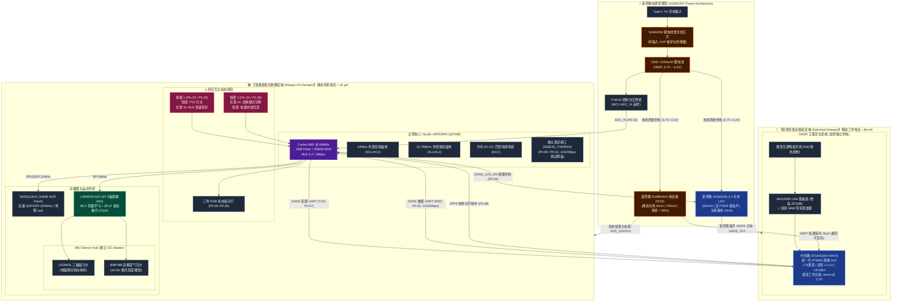
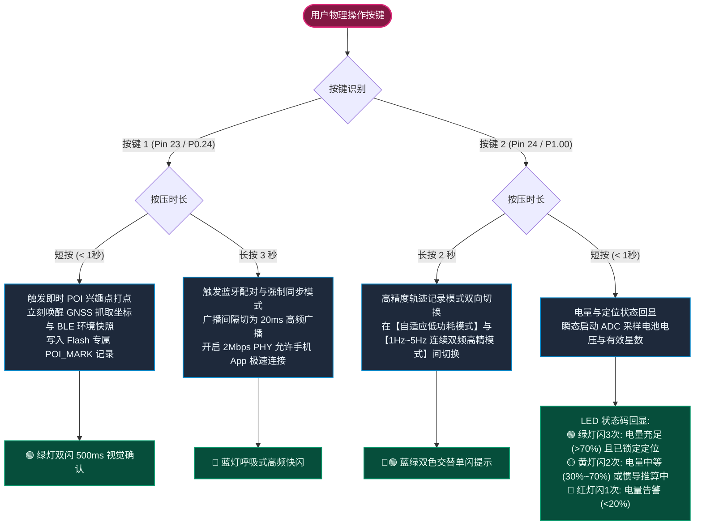
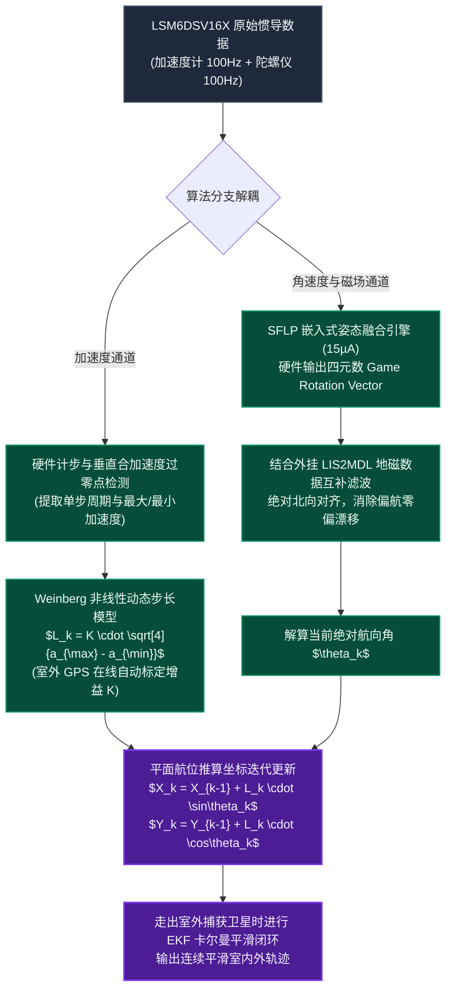

# Life_GPS: 超低功耗全天候 GPS 与惯导(PDR)轨迹记录仪

[](LICENSE)
[-red.svg)](Doc/nRF52840_Product_Specification_v1.11.pdf)
[-green.svg)](Doc/ATGM336H-F8N76_Datasheet.pdf)
[](Doc/LSM6DSV16X_Datasheet.pdf)
[-purple.svg)](Doc/README.md)

**Life_GPS** 是一款专为“一生轨迹（Life Trajectory）”全天候记录、户外越野穿越以及数字游民环境感知打造的**超低功耗微型智能记录仪**。

本项目旨在解决智能手机在全天候开启高精度 GPS 和蓝牙后台扫描时面临的**续航断崖式崩塌（几小时耗尽）、发热严重、系统后台频繁杀进程、隐私数据上传云端**等行业痛点。系统采用创新的**“双域物理隔离（Dual-Domain Isolation）”**低功耗硬件架构，结合高能效无线 SoC、中科微新一代双频多模高精度 GNSS、内置边缘算法的 6 轴惯性测量单元（IMU），以及**全套圣邦微（SGMICRO）纳安级高效电源管理方案（SGM6040A + SGM2036 + SGM4056）**，在配备 **1000mAh ~ 1200mAh** 微型锂电池的物理限制下，实现 **15 至 30 天** 的超长待机与持续记录。

---

## 目录
- [1. 核心设计亮点与相比手机的优势](#1-核心设计亮点与相比手机的优势)
- [2. 关键元器件选型与原厂真实性能参数](#2-关键元器件选型与原厂真实性能参数)
  - [2.1 主控 SoC：Nordic nRF52840 (QFN48 封装)](#21-主控-socnordic-nrf52840-qfn48-封装)
  - [2.2 ⚠️ nRF52840 QFN48 封装功能限制与硬件避坑重点](#22-️-nrf52840-qfn48-封装功能限制与硬件避坑重点)
  - [2.3 GNSS 卫星定位模组：中科微 ATGM336H-F8N76 (双频旗舰款)](#23-gnss-卫星定位模组中科微-atgm336h-f8n76-双频旗舰款)
  - [2.4 6轴惯性测量单元 (IMU)：STMicroelectronics LSM6DSV16X](#24-6轴惯性测量单元-imustmicroelectronics-lsm6dsv16x)
  - [2.5 全套圣邦微 (SGMICRO) 高效电源管理芯片](#25-全套圣邦微-sgmicro-高效电源管理芯片)
- [3. 系统硬件架构：双域物理隔离 Mermaid 拓扑图与对比矩阵](#3-系统硬件架构双域物理隔离-mermaid-拓扑图与对比矩阵)
- [4. 双按键多功能交互定义 (蓝牙配对 / POI打点 / 高精度模式)](#4-双按键多功能交互定义-蓝牙配对--poi打点--高精度模式)
- [5. 时钟源、调试串口与引脚分配 (QFN48 真实物理引脚)](#5-时钟源调试串口与引脚分配-qfn48-真实物理引脚)
- [6. 超低功耗动态调度策略与真实数学预算](#6-超低功耗动态调度策略与真实数学预算)
- [7. GPS 丢失后的惯导与 PDR 行人航位推算方案](#7-gps-丢失后的惯导与-pdr-行人航位推算方案)
- [8. 蓝牙环境扫描与离线数据黑匣子存储](#8-蓝牙环境扫描与离线数据黑匣子存储)
- [9. 无屏幕状态交互与日志调试通道](#9-无屏幕状态交互与日志调试通道)
- [10. 项目工程结构与设计资料索引](#10-项目工程结构与设计资料索引)
- [11. 开发路线图 (Roadmap)](#11-开发路线图-roadmap)

---

## 1. 核心设计亮点与相比手机的优势

| 评估维度 | 智能手机 (App 后台记录) | Life_GPS 专用记录仪 | 核心技术优势剖析 |
| :--- | :--- | :--- | :--- |
| **全天工作续航** | 开启高精度定位+蓝牙扫描仅支撑 **4 ~ 8 小时** | 1000mAh 电池支持 **15 ~ 30 天**（一次充电连续记录整月） | 专用硬件超低功耗架构，无屏幕、无安卓/iOS高负荷操作系统底噪 |
| **电源转换能效** | 手机内部多路电源转换复杂，发热严重 | **圣邦微 SGM6040A 纳安级 DCDC**（60nA静态电流，750mA输出能力） | 告别传统线性 LDO 在 4.2V 下浪费 22% 压差发热的弊端 |
| **系统稳定性** | 操作系统频繁杀后台、省电策略干预导致断轨、丢点 | 专用 RTOS 固件驱动，硬件看门狗保障，**全天候永不断轨** | 硬件级连续守护，状态机自闭环 |
| **遮挡与丢星处理**| 室内、地下商场直接失去定位或发生数百米跳变漂移 | **LSM6DSV16X 硬件融合 + PDR 航位推算**，平滑过渡室内轨迹 | 基于步长自适应模型与四元数航向，室内航位推算误差呈步数线性累加 |
| **环境感知能力** | 手机系统出于权限与隐私严格封锁底层 BLE 原始广播 | 全频段微占空比扫描，抓取并记录周边 Beacon 与穿戴设备 MAC/RSSI | 形成包含“地理位置 + 空间射频环境”的多维离线环境时空轨迹 |
| **设备体积与便携性**| 笨重、发热严重、需随身携带充电宝 | 仅钥匙扣/卡片尺寸（约 52×36×9mm），整机重量 < 35g，随身挂载 | 适合挂在背包外侧、挂坠或放置于车钥匙扣上 |
| **数据安全性与隐私**| 轨迹频繁实时上传云端，面临第三方追踪与商业分析 | **纯离线存储于板载 NOR Flash**，仅由用户物理导出或自主同步 | 真正的数据主权归属个人，物理隔离离线“一生轨迹”底库 |

---

## 2. 关键元器件选型与原厂真实性能参数

### 2.1 主控 SoC：Nordic nRF52840 (QFN48 封装)
* **核心架构**：ARM Cortex-M4F @ 64MHz，集成硬件浮点运算单元（FPU）与专用 DSP 指令集。
* **存储容量**：**1MB 片上 Flash + 256KB RAM**。彻底规避低端芯片（如 nRF52810）RAM 匮乏且官方协议栈阉割“蓝牙扫描（Observer）”的致命缺陷，有充裕内存容纳蓝牙扫描哈希表、RTOS 任务栈及惯导融合滤波。
* **封装优势（QFN48）**：相较于 73 引脚 aQFN 封装，QFN48 拥有 0.4mm 间距的标准四边扁平引脚，PCB 扇出（Fan-out）极为简单，4 层乃至 2 层板即可轻松布通，极大降低打样制板与 SMT 贴片门槛。
* **无线特性**：支持 Bluetooth 5.4、Coded PHY（Long Range 长距离模式）、2Mbps 高速传输。

---

### 2.2 ⚠️ nRF52840 QFN48 封装功能限制与硬件避坑重点
根据 Nordic 官方《nRF52840 Product Specification》（文档第 7.1.2 节及引脚分配表），**QFN48 封装相比标准 aQFN73 封装在硬件功能上有严格的物理级精简**，在原理图和硬件设计中必须重点避坑：

1. **缺失原生 USB 硬件引脚（无 VBUS、D+、D-）**：
   * **原厂物理事实**：QFN48 封装的 48 个引脚中**根本没有引出 VBUS、USB D+ 和 USB D- 管脚**（仅 aQFN73 具备）。
   * **设计对策**：板载 Type-C 接口专用于 5V 锂电池充电输入；日常数据导出主要采用 **BLE 5.0 (2Mbps PHY) 高速无线同步**；同时系统在空闲 GPIO 上**引出了专用的独立硬件调试串口（DEBUG_UART: TXD/RXD）测试焊盘**，用于连接外部 USB-TTL 串口板输出固件实时 Log。
2. **高压供电模式（High Voltage Supply Mode，REG0）内部短接失效**：
   * **原厂规格书明文**：*“Note: VDD and VDDH are shortcircuited inside the package. Therefore the device is only usable in Normal Voltage supply mode, and not High Voltage supply mode.”*
   * **设计对策**：**严禁将单节锂电池（3.7V~4.2V）或 USB 5V 直接接给 nRF52840 芯片电源管脚**！系统必须由圣邦微 SGM6040A 降压 DCDC 将电池电压高效转换为 3.0V/3.3V 后输入 VDD，工作在 Normal Voltage Supply Mode（1.7V~3.6V）。
3. **真实可用 GPIO 数量精简至 28 个**：
   * aQFN73 引出 48 个 GPIO，而 QFN48 **仅引出 28 个有效 GPIO**：
     * P0 端口保留 24 个管脚（**缺失 P0.06、P0.15、P0.16、P0.25、P0.26、P0.27**）；
     * P1 端口大部分被裁剪，**仅引出 P1.00、P1.08、P1.09、P1.15 四个管脚**（其余全部缺失）。
   * **设计对策**：本工程已严格基于 QFN48 的真实 28 个物理引脚编排所有外设总线，杜绝任何不存在引脚的连线错误。
4. **外部时钟晶振引脚规划**：
   * 必须在专用管脚 `XC1 (Pin 35)` 和 `XC2 (Pin 36)` 外挂 **32MHz 高频石英晶体（HFXO）**，这是 2.4GHz BLE 射频与 64MHz 主频运行的必需时基；
   * 必须在 `P0.00/XL1 (Pin 2)` 和 `P0.01/XL2 (Pin 3)` 外挂 **32.768kHz 低频石英晶体（LFXO）**，为睡眠状态下的 RTC 提供微安级超低功耗时基。

---

### 2.3 GNSS 卫星定位模组：中科微 ATGM336H-F8N76 (双频旗舰款)
> **权威规格依据**：依据中科微原厂官方《ATGM336H-F8N 模块用户手册》，本型号为中科微新一代基于 **AT9880 旗舰 SoC 架构** 的**全系统多频点（双频 L1+L5）高性能 GNSS 定位导航与高精度授时模组**：

| 关键参数项目 | 官方规格书真实数据 | 详细特性与工程说明 |
| :--- | :--- | :--- |
| **核心 SoC 芯片** | **中科微新一代 AT9880** | 多频多系统 GNSS SoC 单芯片，集成高性能嵌入式 CPU |
| **支持卫星频点** | **L1 + L2/L5 多频点** | **BDS (B1I+B1C+B2a/B2b), GPS (L1+L2/L5), GALILEO (E1+E5a/E5b), GLONASS (L1), IRNSS (L5), QZSS, SBAS** |
| **物理跟踪通道** | **176 通道** | 可同时跟踪多星座数十颗有效卫星，具备极强电离层延迟消除与多径抑制能力 |
| **跟踪灵敏度** | **-167 dBm** | 处于行业顶级水准（冷启动捕获 -148dBm，热启动捕获 -156dBm，重捕获 -160dBm） |
| **定位 / 测速精度** | **< 1.0 m (CEP50)** / **< 0.1 m/s (1σ)** | 优于传统单频模块 2.5m 精度，城市峡谷与林荫道定位更平滑 |
| **启动时间 (TTFF)** | 冷启动 $\le 30\text{ s}$，**热启动 $\le 1\text{ s}$**，重捕获 $\le 1\text{ s}$ | 具备后备电源 VBAT 时，重新通电瞬间实现秒定 |
| **最大定位更新率** | **最高 20 Hz** (默认 1Hz) | 满足户外冲刺、运动竞技及高精度赛段轨迹记录需求 |
| **串口通信特性** | **默认 115200 bps**，8-N-1 | 相比老款 9600bps 提速 12 倍，大幅缩短数据吐出时间，帮助 MCU 提早休眠 |
| **运行功耗参数** | **典型电流 44 mA @ 3.3V** (L1+L5双频满载) | 待机功耗 **< 20 µA**，RTC后备电源 VBAT 供电电流仅 **15 µA** |
| **独立供电架构** | **圣邦微 SGM2036-3.3 专用 LDO 供电** | **带 EN 使能脚硬切断（关断漏电仅 10nA）**，低噪声高 PSRR 隔绝电源杂波 |
| **射频前端设计** | 模块引出 3.3V `VCC_RF`，带天线检测与短路保护 | 随身微型无源陶瓷天线外加 **MAX2659 LNA (增益 20.5dB, 噪声 0.8dB)** + 窄带声表滤波器 (SAW) |

---

### 2.4 6轴惯性测量单元 (IMU)：STMicroelectronics LSM6DSV16X
* **传感器规格**：3 轴数字加速度计（±2g 至 ±16g） + 3 轴数字陀螺仪（±125 至 ±4000 dps）。
* **嵌入式边缘智能三核架构**：
  1. **MLC (Machine Learning Core)**：硬件级机器学习决策树，微安级功耗实时识别静止、步行、慢跑、乘车等活动模式；
  2. **FSM (Finite State Machine)**：8 个独立可编程有限状态机，负责瞬态动作提取与手势监测；
  3. **SFLP (Sensor Fusion Low Power)**：嵌入式超低功耗传感器融合算法引擎，**仅消耗 15 µA** 即可在传感器内部直接硬件输出 6 轴/9 轴姿态四元数（Game Rotation Vector）。
* **扩展能力 (Sensor Hub)**：具备独立 I2C Master，可直接外挂三轴磁力计（**LIS2MDL**）与高精度气压计（**BMP388**），数据统一打包进内部 FIFO，免去频繁唤醒主控 CPU。
* **触摸感知**：具备 **Qvar** 静电电荷变化检测通道，支持设备外壳轻击、滑动手势及人体穿戴检测。

---

### 2.5 全套圣邦微 (SGMICRO) 高效电源管理芯片
为兼顾极致续航、高电源抑制比（PSRR）与完全自主可控供应链，本项目电源部分全部采用**圣邦微电子（SGMICRO）**成熟物料：

1. **主控系统降压 DCDC：圣邦微 SGM6040A**
   * **纳安级超低静态电流**：静态待机电流低至 **60 nA**（0.06 µA），关断电流典型仅 **25 nA**；
   * **微载荷极限效率**：在 $1\text{ }\mu\text{A}$ 微载荷输出下效率依然高达 **80%**，重载峰值效率超过 **90%**；
   * **输出能力与特性**：输入 1.8V ~ 5.5V，最大输出电流 **750 mA**；通过 VSET 引脚单颗精密电阻即可配置 16 种预设输出电压（推荐配置为 3.0V 或 3.3V）；具备 100% 占空比旁路模式（Bypass 模式下 $I_Q$ 仅 120nA）；
   * **STOP 硬件低噪引脚**：具备 STOP 硬件控制脚，在 MCU 执行高灵敏度 ADC 采样时可瞬态冻结开关动作消除开关噪声。
2. **GNSS 独立低噪声 LDO：圣邦微 SGM2036-3.3**
   * **专路专供**：ATGM336H-F8N76 射频定位模组工作电流大（44mA）且对电源纹波极度敏感。SGM2036 提供高达 300mA 洁净低纹波电源，彻底杜绝 DCDC 开关纹波串入卫星天线前端；
   * **受控物理切断**：具备逻辑使能脚（EN），由 nRF52840 GPIO `P0.04` 控制。休眠时拉低 EN，**关断漏电流仅 10 nA**，实现零漏电硬隔离。
3. **锂电池充电管理：圣邦微 SGM4056**
   * **保护与充电**：1A 单节锂离子/锂聚合物线性充电器，恒流/恒压充电曲线，集成高达 26.5V 耐压与输入过压保护（OVP 6.8V），防电池倒灌漏电 $< 1\text{ }\mu\text{A}$，具备 CHRG 充电状态指示。
4. **外部存储芯片：Winbond W25Q128JV**
   * 16MB SPI/QSPI NOR Flash，支持高速 32MHz，深休眠电流仅 $1\text{ }\mu\text{A}$，用于海量轨迹黑匣子存储。

---

## 3. 系统硬件架构：双域物理隔离 Mermaid 拓扑图与对比矩阵

### 3.1 系统双域架构 Mermaid 流程图



### 3.2 供电与功耗域对比矩阵 (Domain Contrast Matrix)

| 架构对比维度 | 🟢 常通超低功耗微安域 (Always-On Domain) | 🔵 受控突发高能毫安域 (Switched GNSS Domain) |
| :--- | :--- | :--- |
| **所属核心硬件** | **nRF52840 SoC、LSM6DSV16X IMU、W25Q128JV Flash** | **ATGM336H-F8N76 GNSS 模组、MAX2659 LNA 射频前端** |
| **独立供电通道** | **圣邦微 SGM6040A 纳安级 DCDC** (静态电流 60nA, 750mA 输出) | **圣邦微 SGM2036-3.3 专用受控 LDO** (300mA, 高 PSRR, 低噪声) |
| **供电控制机制** | 全天候常通供电，维持系统时基与状态监听 | **通过 MCU GPIO `P0.04` 控制 SGM2036 的 EN 脚**实现硬件级通断 |
| **静态休眠电流** | **$< 15\text{ }\mu\text{A}$** (System ON + RTC + SFLP 融合 + Flash深休眠) | **$< 0.01\text{ }\mu\text{A}$** (SGM2036 关断漏电仅 10nA，彻底消除静电漏电) |
| **动态运行电流** | $0.65\text{ mA} \sim 8\text{ mA}$ (BLE 广播/扫描/姿态运算) | **$44\text{ mA} \sim 48\text{ mA}$** (双频 176 通道满载搜星 + LNA 放大) |
| **运行占空比** | 100% 全天候在线守护 | 脉冲式快照工作（常规运动下仅占空约 **3% ~ 6%**） |
| **后备保活设计** | 主控保持高精度时间戳与事件哈希表 | 模组 `VBAT` 引脚接常通 3.3V (15µA)，保证 RTC/SRAM 热启动秒定 |

---

## 4. 双按键多功能交互定义 (蓝牙配对 / POI打点 / 高精度模式)

设备采用无屏幕超薄设计，为了提供强大且直观的操作体验，硬件配备了 **2 个独立多功能轻触按键**，覆盖了日常使用、兴趣点记录与特殊工况切换三大场景：

### 4.1 双按键操作逻辑流程图 (Mermaid)



---

## 5. 时钟源、调试串口与引脚分配 (QFN48 真实物理引脚)

### 5.1 外部高低频时钟源规划
* **32MHz 外部高频晶振 (HFXO)**：接至专用管脚 `XC1 (Pin 35)` 和 `XC2 (Pin 36)`，匹配 12pF 负载电容，频差 $\le \pm 10\text{ ppm}$，为 2.4GHz BLE 射频与 64MHz CPU 提供精准时基；
* **32.768kHz 外部低频晶振 (LFXO)**：接至专用管脚 `P0.00/XL1 (Pin 2)` 和 `P0.01/XL2 (Pin 3)`，匹配 9pF/12.5pF 负载电容，为睡眠 RTC 计时提供微安级时基。

### 5.2 独立预留硬件调试串口 (DEBUG_UART)
为满足开发过程中的日志捕获与固件调试，系统分配了独立于 GNSS 的硬件调试串口：
* **`DEBUG_TXD`**：分配至 `P0.09` (Pin 29)，引出板载测试焊盘 (TP)，波特率 115200bps，输出实时系统 Log；
* **`DEBUG_RXD`**：分配至 `P0.10` (Pin 30)，引出板载测试焊盘 (TP)，用于接收配置调试指令；
* *注：P0.09/P0.10 默认具 NFC 保护电容，在固件 UICR 配置中必须配置 `NFCPINS = 0`，以释放为标准数字 GPIO。*

### 5.3 nRF52840 QFN48 完整物理引脚分配映射表
系统完全基于 QFN48 真实的 28 个有效物理 GPIO 规划，无任何不存在管脚：

| 物理管脚编号 | 端口网络标号 | I/O方向 | 硬件连接与电气功能描述 |
| :--- | :--- | :---: | :--- |
| **Pin 35 / Pin 36**| `XC1 / XC2` | IN/OUT | **32MHz 外部高频石英晶体 (HFXO)**，BLE 射频与 CPU 必需基准 |
| **Pin 2 / P0.00** | `RTC_XTAL_IN (XL1)` | IN | **32.768 kHz 外部低频晶体 (LFXO)** 输入端，微安待机时基 |
| **Pin 3 / P0.01** | `RTC_XTAL_OUT (XL2)`| OUT | **32.768 kHz 外部低频晶体 (LFXO)** 输出端 |
| **Pin 40 / P0.02** | `BAT_ADC_IN (AIN0)` | IN | 电池电压分压采集模拟输入（Standard Drive，低频） |
| **Pin 39 / P0.03** | `BAT_ADC_EN (AIN1)` | OUT | 电池分压回路使能控制（平时高电平截止，采样时拉低导通 P-MOS） |
| **Pin 4 / P0.04** | `GNSS_LDO_EN` | OUT | **控制圣邦微 SGM2036 LDO 的 EN 脚**（高电平通电，低电平硬切断） |
| **Pin 5 / P0.05** | `GNSS_RXD` | IN | UART 接收引脚（连接 ATGM336H 的 TXD0，波特率 115200） |
| **Pin 6 / P0.07** | `GNSS_TXD` | OUT | UART 发送引脚（连接 ATGM336H 的 RXD0，替代不存在的 P0.06） |
| **Pin 7 / P0.08** | `GNSS_PPS` | IN | 接收 ATGM336H 1PPS 授时脉冲（纳秒级时间对齐） |
| **Pin 29 / P0.09** | `DEBUG_TXD` | OUT | **独立调试串口 TX**（115200bps，引出测试焊盘，UICR配置NFCPINS=0） |
| **Pin 30 / P0.10** | `DEBUG_RXD` | IN | **独立调试串口 RX**（引出测试焊盘，UICR配置NFCPINS=0） |
| **Pin 10 / P0.11** | `IMU_CS` | OUT | LSM6DSV16X SPI 片选引脚（Active Low） |
| **Pin 11 / P0.12** | `IMU_SCK` | OUT | LSM6DSV16X SPI 时钟信号（最高支持 8MHz） |
| **Pin 13 / P0.13** | `IMU_MISO` | IN | LSM6DSV16X SPI 主机输入引脚 |
| **Pin 14 / P0.14** | `IMU_MOSI` | OUT | LSM6DSV16X SPI 主机输出引脚 |
| **Pin 15 / P0.17** | `IMU_INT1` | IN | LSM6DSV16X 中断 1（静止休眠唤醒、计步事件中断） |
| **Pin 8 / P1.08** | `IMU_INT2` | IN | LSM6DSV16X 中断 2（FIFO 阈值满中断、MLC 运动模式识别） |
| **Pin 9 / P1.09** | `FLASH_CS` | OUT | W25Q128JV NOR Flash 片选引脚（Active Low） |
| **Pin 18 / P0.19** | `FLASH_SCK` | OUT | Flash 高速时钟信号（具备 QSPI/SCK 硬件驱动能力，32MHz） |
| **Pin 19 / P0.20** | `FLASH_MOSI` | OUT | Flash 数据输入引脚 (SPI MOSI / QSPI IO0) |
| **Pin 20 / P0.21** | `FLASH_MISO` | IN | Flash 数据输出引脚 (SPI MISO / QSPI IO1) |
| **Pin 21 / P0.22** | `FLASH_WP` | OUT | Flash 写保护控制 (QSPI IO2) |
| **Pin 22 / P0.23** | `FLASH_HOLD` | OUT | Flash 保持控制 (QSPI IO3) |
| **Pin 16 / P0.18** | `SYS_RESET` | IN | 硬件复位引脚 / SWD 调试复位 |
| **Pin 26 / Pin 27**| `SWDIO / SWDCLK` | I/O | SWD 固件烧录与在线仿真调试接口 |
| **Pin 23 / P0.24** | `KEY1_PAIR_POI` | IN | **多功能按键 1**（短按：POI 打点；长按 3s：蓝牙配对与同步） |
| **Pin 24 / P1.00** | `KEY2_MODE_ST` | IN | **多功能按键 2**（长按 2s：高精模式切换；短按：电量状态回显） |
| **Pin 41 / P0.28** | `LED_RED` | OUT | 系统状态红灯（低电平点亮/PWM，错误或低电量提示） |
| **Pin 42 / P0.29** | `LED_GREEN` | OUT | 系统状态绿灯（GNSS 定位成功与 POI 打点确认） |
| **Pin 43 / P0.30** | `LED_BLUE` | OUT | 系统状态蓝灯（BLE 广播配对与数据传输中） |
| **Pin 38 / P1.15** | `RESERVED` | - | 预留备用 GPIO |
| **Pin 44 / P0.31** | `RESERVED` | - | 预留外部扩展测试点 |

---

## 6. 超低功耗动态调度策略与真实数学预算

### 6.1 记录模式特性对比 (Mode Contrast Matrix)

| 模式对比维度 | 模式 A：超低功耗自适应模式 (默认) | 模式 B：高精度连续记录模式 (按键2切换) |
| :--- | :--- | :--- |
| **主要定位方式** | 脉冲式快照定位 (Snapshot GNSS) | 连续高频卫星跟踪 + 高频惯导融合 |
| **GNSS 供电与占空比** | **3% ~ 6%** (SGM2036 脉冲式通电 2~3 秒锁定即切断) | **100% 常开运行** (SGM2036 持续输出洁净电源) |
| **定位更新频率** | 动态心跳 (静止关闭，行走 30~60s 一次) | **1 Hz ~ 5 Hz 连续输出** (最高支持 20Hz) |
| **电源转换能效** | SGM6040A 静态功耗仅 60nA，轻载效率 80%，重载 >90% | DCDC 持续高效降压转换，杜绝线性压差发热 |
| **适用场景** | 日常生活记录、城市通勤、多日户外徒步 | 越野赛道跑、山地骑行攻顶、复杂弯道精准打点 |
| **整机平均工作电流** | **$\approx 1.10\text{ mA}$** (折算至电池侧日均能耗 26.4 mAh) | **$\approx 42\text{ mA}$** (经 DCDC 降压变换后电池端电流) |
| **1000mAh 电池续航** | **$\ge 30\text{ 天}$ (满足整月记录)** | **$\approx 21 \sim 24\text{ 小时}$ (满足全天专业运动竞赛)** |

### 6.2 默认自适应模式的真实功耗数学模型 (以 1000mAh 电池为例)
*扣除电池化学老化与转换效率损耗，按 **900 mAh 真实有效可用电量** 计算；得益于圣邦微 SGM6040A 纳安级 DCDC（仅 60nA 静态电流）与高效开关降压（3.7V~4.2V 折算至 3.0V 系统端节省近 20% 电流）：*

| 工作工况阶段 | 每日持续时长 / 频率 | 阶段典型工作电流 | 每日等效耗电贡献 (mAh/天) |
| :--- | :--- | :--- | :--- |
| **阶段 1：深度静止待机 (按每日 14 小时计)** | 14 小时保持静止 | 12 µA (SGM6040A 60nA+MCU睡眠+IMU低功耗) | $0.012\text{ mA} \times 14\text{ h} \approx \mathbf{0.17\text{ mAh}}$ |
| **阶段 2：运动 GNSS 脉冲快照 (按每日 10 小时计)** | 每 45 秒开机 2.5 秒 (占空比 5.5%) | 48 mA (SGM2036供电: ATGM336H 44mA + LNA 4mA) | $48\text{ mA} \times 5.5\% \times 10\text{ h} \approx \mathbf{26.40\text{ mAh}}$ |
| **阶段 3：LSM6DSV16X 姿态解算 (DCDC降压)** | 10 小时运动期间连续运行 | 0.55 mA (3.0V端0.65mA折算至电池端) | $0.55\text{ mA} \times 10\text{ h} \approx \mathbf{5.50\text{ mAh}}$ |
| **阶段 4：BLE 微占空比环境扫描 (DCDC降压)** | 每 30 秒扫描 500ms (占空比 1.6%) | 6.8 mA (3.0V端8mA折算至电池端) | $6.8\text{ mA} \times 1.6\% \times 10\text{ h} \approx \mathbf{1.09\text{ mAh}}$ |
| **阶段 5：Flash 扇区写入与系统底噪** | 突发缓冲写入 | 均摊 1.2 mA | $\approx \mathbf{1.20\text{ mAh}}$ |
| **每日总耗电量预算合计** | - | - | **$\approx 34.36\text{ mAh / 天}$** |

$$\text{实测续航天数} = \frac{900\text{ mAh}}{34.36\text{ mAh/天}} \approx \mathbf{26.2\text{ 天}}$$
若搭配 **1200mAh 电池**（有效电量 1080mAh），自适应模式下续航即可稳健达到 **$\mathbf{31.4\text{ 天}}$（整整一个月无需充电）**！

---

## 7. GPS 丢失后的惯导与 PDR 行人航位推算方案

### 7.1 室内与遮挡丢星的技术救赎
在进入大型地下车库、隧道、密集高楼群或室内商场时，卫星信号严重衰减。若盲目保持 GNSS 模组通电搜索，不仅无法定位，反而会导致 48mA 的大电流快速耗尽电池。

系统状态机会在连续 15 秒无法定位时**拉低 `P0.04 (GNSS_LDO_EN)` 果断切断 SGM2036 LDO 电源**，无缝切换为基于 **LSM6DSV16X 的 PDR 行人航位推算（Pedestrian Dead Reckoning）**算法接管：



---

## 8. 蓝牙环境扫描与离线数据黑匣子存储

### 8.1 蓝牙环境感知
* **被动监听扫描**：采用微占空比定期 Passive 扫描，接收周围所有非连接态 BLE 广播包。
* **数据过滤与去重**：
  * 解析 iBeacon / Eddystone 协议（记录 UUID、Major、Minor、RSSI）；
  * 识别高频出现的穿戴设备、智能单车及固定基站的 MAC 地址；
  * 内存中维护布隆过滤器（Bloom Filter）对同一静止环境下的重复 MAC 进行去重，节省 Flash 空间。

### 8.2 紧凑型二进制存储格式 (Binary Storage Layout)
板载 16MB NOR Flash 划分为循环逻辑扇区，每条记录严格固定为 **32 字节**：

```c
#pragma pack(push, 1)
typedef struct {
    uint32_t timestamp;      // UNIX 时间戳 (UTC, 秒级)
    int32_t  latitude;       // 纬度 (度 * 1e7)
    int32_t  longitude;      // 经度 (度 * 1e7)
    int16_t  altitude;       // 海拔高度 (米, -500 ~ 9000)
    uint16_t speed_hdop;     // 地速(低8位, 0.1km/h) + HDOP(高8位, 0.1)
    uint16_t heading;        // 航向角 (0 ~ 359.9 度, 分辨率 0.1 度)
    uint16_t step_count;     // 累计步数增量 (PDR 记录)
    uint8_t  status_flags;   // 状态位: 0x01=GNSS有效, 0x02=PDR接管, 0x04=POI打点, 0x08=高精模式
    uint8_t  battery_level;  // 剩余电量百分比 (0 ~ 100%)
    uint8_t  ble_mac[6];     // 附近最强 RSSI 蓝牙设备 MAC 地址
    int8_t   ble_rssi;       // 蓝牙信号强度 (-128 ~ 0 dBm)
    uint8_t  crc8;           // 数据校验和
} TrajectoryRecord_t;        // 总长度正好 32 字节
#pragma pack(pop)
```
* **存储容量**：16MB Flash 可存储超过 **450,000 条** 完整记录。在常规自适应模式下可**连续保存数月以上**的精细数据。

---

## 9. 无屏幕状态交互与日志调试通道

### 9.1 三色超低功耗 RGB LED 状态灯语定义
| LED 指示形态 | 当前系统状态 | 触发条件说明 |
| :--- | :--- | :--- |
| **双闪绿灯** (点亮 50ms) | GNSS 成功定位 / POI 打点确认 | 单次快照定位完成写入或短按 KEY1 打点成功 |
| **单闪蓝灯** (点亮 50ms) | BLE 连接与同步就绪 | 处于低占空比周期性广播中 |
| **高频快闪蓝灯** | BLE 极速配对 / 批量数据拉取中 | 长按 KEY1 启动配对，App 正在同步离线轨迹 |
| **蓝绿交替闪烁** | 高精度连续记录模式激活中 | 长按 KEY2 开启高精度模式 |
| **单闪黄灯** | 室内 PDR 惯性航位推算接管 | GNSS 卫星信号丢失，IMU 算法运行中 |
| **快闪红灯** | 电量极低 (< 10%) 或存储已满 | 提醒用户及时充电或导出清理数据 |

### 9.2 调试与数据同步通道
1. **日常手机无线同步**：通过 BLE 5.0 (2Mbps PHY) 与手机 App 配对，秒级同步轨迹，支持导出 `.gpx`、`.kml` 或 `.geojson` 格式。
2. **硬件独立调试串口 (DEBUG_UART)**：板载预留带防呆标识的 `DEBUG_TXD (P0.09)` 和 `DEBUG_RXD (P0.10)` 测试焊盘，连接 USB-TTL 串口小板即可在 PC 终端上实时查看带毫秒时戳的底层运行 Log（双频载噪比 C/N0、PDR 四元数、BLE 原始广播包）。

---

## 10. 项目工程结构与设计资料索引

```
Life_GPS/
├── Doc/                                         # 官方芯片规格书与硬件原厂参考手册
│   ├── README.md                                # 规格书索引与设计避坑指南 (含QFN48与SGM6040A电源说明)
│   ├── ATGM336H-F8N76_Datasheet.pdf             # 中科微 ATGM336H-F8N (AT9880双频) 官方用户手册
│   ├── nRF52840_Product_Specification_v1.11.pdf # Nordic nRF52840 产品规格书 (含QFN48引脚与限制)
│   ├── LSM6DSV16X_Datasheet.pdf                 # STMicroelectronics LSM6DSV16X 6轴 IMU 规格书
│   ├── SGM6040A_Datasheet.pdf                   # 圣邦微 SGM6040A 60nA 超低功耗降压 DCDC 规格书
│   ├── SGM2036_Datasheet.pdf                    # 圣邦微 SGM2036 300mA 低噪声受控 LDO 规格书
│   ├── SGM4056_Datasheet.pdf                    # 圣邦微 SGM4056 线性锂电充电 IC 规格书
│   ├── LIS2MDL_Datasheet.pdf                    # STMicroelectronics LIS2MDL 3轴磁力计规格书
│   ├── BMP388_Datasheet.pdf                     # Bosch BMP388 高精度气压计规格书
│   ├── MAX2659_GPS_LNA.pdf                      # Maxim/ADI MAX2659 GPS 专用低噪放规格书
│   └── W25Q128JV_SPI_Flash.pdf                  # 华邦 16MB SPI NOR Flash 规格书
├── Hardware/                                    # 硬件设计工程文件 (立创 EDA / KiCad)
│   ├── Schematics/                              # 原理图设计与 PDF 导出
│   ├── PCB/                                     # PCB 布局布线工程与 Gerber 光绘文件
│   └── BOM/                                     # 元器件物料清单
├── Firmware/                                    # 嵌入式固件源码 (基于 Zephyr RTOS / nRF Connect SDK)
│   ├── drivers/                                 # 传感器与外设底层驱动 (LSM6DSV16X, ATGM336H, SGMICRO)
│   ├── algorithms/                              # 惯导与航位推算算法 (PDR, SFLP, EKF)
│   └── app/                                     # 业务逻辑、低功耗状态机与数据存储
└── README.md                                    # 本项目总览与架构设计说明
```

---

## 11. 开发路线图 (Roadmap)

- [x] **架构设计与选型论证**：完成主控（nRF52840 QFN48）、双频 GNSS（ATGM336H-F8N76）、IMU（LSM6DSV16X）及全套圣邦微电源（SGM6040A 60nA DCDC + SGM2036 LDO + SGM4056）的系统论证与功耗数学建模。
- [x] **技术资料归档**：收集并整理全部关键核心器件原厂规格书放入 `Doc/` 目录，剔除错误历史手册。
- [x] **芯片限制与封装适配**：明确 nRF52840 QFN48 供电限制（无高压模式）及 USB 引脚缺失，重新规划 28 个物理 GPIO，独立分配调试串口 DEBUG_UART，并规划 32MHz HFXO 与 32.768kHz LFXO 双晶体。
- [x] **交互架构升级**：确立 KEY1 与 KEY2 双按键在蓝牙配对、POI 打点与高精度模式切换的功能定义。
- [ ] **硬件原理图绘制**：
  - [ ] 完成 SGM4056 充电电路与 SGM6040A 60nA 超低功耗降压 DCDC 电路（VSET 单电阻配置 3.0V/3.3V 输出）；
  - [ ] 完成 SGM2036-3.3 独立受控 LDO 供电与 ATGM336H-F8N76 射频前端（无源双频陶瓷天线 + MAX2659 LNA + 双频 SAW）；
  - [ ] 完成 nRF52840 QFN48 最小系统、32MHz/32.768kHz 双晶体电路与 DEBUG_UART 测试焊盘；
  - [ ] 完成 LSM6DSV16X 与 Sensor Hub（LIS2MDL、BMP388）总线连接；
  - [ ] 完成双按键消抖电路、三色 LED 指示灯及电池微安级分压采样电路。
- [ ] **PCB 布局布线与打样**：4 层高密度沉金板设计，严格控制射频 50Ω 阻抗并隔离高频噪声。
- [ ] **固件开发与算法验证**：
  - [ ] 基于 Zephyr / nRF Connect SDK 搭建超低功耗电源管理框架；
  - [ ] 移植 ST 官方 MLC / SFLP 驱动库并实现离线步长自适应 PDR 算法；
  - [ ] 实现自定义二进制黑匣子 Flash 存储系统与 BLE 高速数据拉取。
- [ ] **整机组装与户外长周期实测**：30 天实地续航与轨迹平滑度测试验证。

---

## 许可协议 (License)
本项目硬件设计与固件代码遵循 **MIT License** 开源协议。详情请参阅 [LICENSE](LICENSE) 文件。
